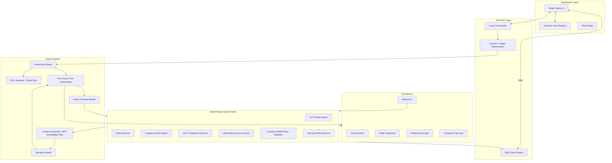
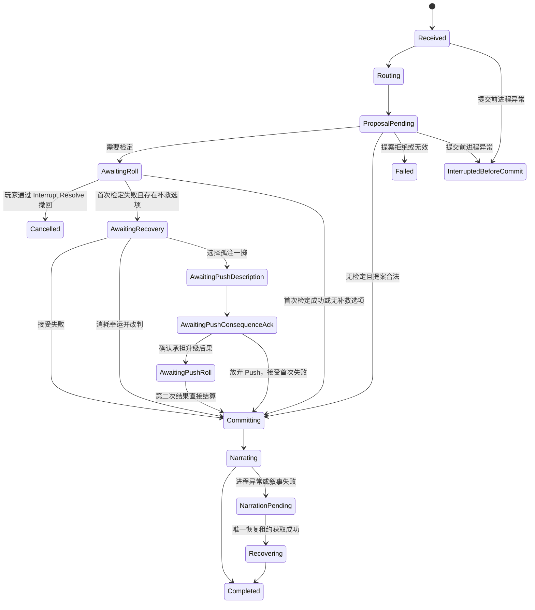

# TRPG AI KP --- 架构设计与技术选型

> **文档版本**：v0.3.1\
> **状态**：冻结实施基线（V0 垂直切片）；重大偏离必须通过 RFC 记录和评审\
> **产品目标**：打造一个玩家愿意连续游玩数小时、结束后仍想开启下一场冒险的
> AI Keeper（AI KP）\
> **V1 目标形态**：CoC 7e 调查向、单人玩家、原创短模组、完整 Web
> 游戏体验\
> **技术方向**：Rust-first Backend + React / TypeScript Frontend\
> **核心原则**：体验优先、状态可信、交互流畅；技术服务于游戏，不让玩家感受到不必要的工程复杂度。

------------------------------------------------------------------------

## 0. 文档约定

### 0.1 规范用语

-   **MUST**：V1 必须满足，是正确性或体验底线。
-   **SHOULD**：强烈建议，除非有明确理由，否则应实现。
-   **MAY**：可选能力，不应阻塞 V1。
-   **V0.1～V0.5**：V0 垂直切片的工程阶段；
-   **V1 / V1.5 / V2 / V3**：产品交付阶段，不代表未来功能必须按当前实现方式开发。

### 0.2 本文档定义

1.  产品定位、体验目标和成功指标；
2.  系统架构、运行时职责和回合状态机；
3.  Rust 后端技术选型及性能原则；
4.  确定性游戏内核与 CoC 规则边界；
5.  Module IR、线索、场景、NPC 和秘密权限；
6.  Dynamic View Protocol（DVP）；
7.  模型调用、上下文装配与信息传播；
8.  持久化、ActiveTurnBuffer、恢复和幂等；
9.  REST / SSE 通信；
10. 前端体验模式、Turn 0 和 Case Debrief；
11. 评测、开发路线、项目结构和验收标准；
12. 并发、SSE 补发、崩溃恢复、玩家诈唬和 DVP 呈现时序的实施约束。

### 0.3 当前版本的定位

本版本冻结架构方向，作为 V0 垂直切片的实施基线。冻结不代表性能和体验已经得到证明；以下事项仍须通过垂直切片和真实试玩验证：

-   模型供应商与具体模型；
-   真实模型延迟与成本；
-   SSE 重连和进程异常恢复；
-   真实玩家对三种体验模式的反馈；
-   Rust 实现是否需要进一步优化；
-   Session 锁、SSE Catch-up 和 Recovery Lease 的并发正确性；
-   Bluff、NPC 信息来源与 DVP 呈现时序是否符合真实玩家预期。

不要把尚未实测的性能目标写成已经达成的承诺。

------------------------------------------------------------------------

# 1. 产品定位与设计纲领

## 1.1 产品定义

我们不是在开发一个"能够运行跑团规则的
Agent"，而是在开发一个玩家愿意连续玩几个小时、玩完之后还想开启下一场冒险的
AI KP。

产品不是暗色主题的聊天框，也不是把预设选项包装成自由输入的 Galgame。

它应该让玩家感受到：

-   我可以尝试任何合理的行动，而不是只能点击作者预设的选项；
-   世界会记住我做过的事，并对我的行动产生可信后果；
-   NPC 有自己的性格、动机、认知边界和表达方式；
-   规则公平、骰子可信，但规则不会阻断创造性行动；
-   叙事有节奏，关键时刻有张力，普通时刻不啰嗦；
-   关键决定由我做出，AI 不会替我扮演角色；
-   游戏界面会随着故事变化，而不是始终显示一张聊天记录；
-   玩完一场之后，我愿意继续探索这个世界。

## 1.2 Design Manifesto

以下原则是产品和技术决策的最高依据。

1.  **Experience First**：玩家体验优先于架构复杂度。
2.  **Player Sovereignty**：除规则明确规定的非自主效果外，AI
    不替玩家决定思想、情绪和关键行动。
3.  **Freedom within
    Rules**：规则用于裁定行动后果，而不是限制玩家只能沿预设剧情行动。
4.  **Invisible
    Engineering**：状态机、权限、事件日志和模型路由留在后台，前端呈现自然的游戏体验。
5.  **Deterministic Truth, Creative
    Narrative**：骰子、数值、物品、权限和已提交世界事实由代码负责；叙事、表演和合理即兴发挥由模型负责。
6.  **Dramatic
    World**：世界演化服务于戏剧张力，不追求无意义的后台拟真模拟。
7.  **Minimal Necessary Agents**：节点不等于
    Agent。只有独立认知确实带来体验提升时，才增加额外模型调用。
8.  **Playable First**：先交付一个完整可玩的短模组，再扩展平台能力。
9.  **Evaluate the
    Experience**：既评估工程正确性，也评估玩家是否愿意继续玩。
10. **Fast Feedback, Honest
    Latency**：先给玩家明确反馈，再交付叙事；不以虚假的"正在思考"掩盖无效等待。

## 1.3 产品优先级

  优先级   目标                 玩家感受
  -------- -------------------- --------------------------------
  P0       玩家自主性           我可以尝试任何合理的事情
  P0       叙事沉浸感           我仿佛置身于一个真实的故事
  P0       世界与规则可信度     我的行动有合理且持续的后果
  P0       交互流畅度           不需要频繁等待、确认或操作
  P1       NPC 表现力           人物有性格、动机、记忆和潜台词
  P1       长期一致性           世界记得我做过什么
  P1       信息公平性           不剧透、不作弊、不暗中操纵
  P1       动态视听反馈         界面随着故事变化
  P2       通用模组生态         能导入和编辑更多模组
  P2       分支存档与多人游戏   支持更复杂的游戏形态

## 1.4 体验成功指标

必须持续关注：

-   玩家是否愿意继续下一回合；
-   玩家是否愿意完成当前模组；
-   玩家是否愿意开启第二场冒险；
-   玩家是否觉得自己的行动真正影响了世界；
-   玩家是否觉得 NPC 有可信的人格；
-   玩家是否经常遇到无意义等待、重复确认或规则打断；
-   玩家是否觉得叙事冗长、机械、过度煽情或缺乏张力。

"想开启下一场冒险"是核心产品指标之一，不能只用规则正确率代替。

------------------------------------------------------------------------

# 2. 总体架构与职责边界

## 2.1 三方职责边界

  能力               LLM        Game Kernel              Player
  ------------------ ---------- ------------------------ --------------------------
  理解自由输入       主责       校验结构与约束           发起
  即兴创造合理内容   提出方案   校验并提交合法变化       决定是否尝试
  NPC 人格演绎       主责       提供授权认知             交互
  叙事文笔与节奏     主责       提供已裁定事件           体验
  是否需要检定       提议       校验规则与条件           确认关键检定
  检定难度           提议       按规则和模组约束裁定     可补充行动
  骰子与数值结算     禁止篡改   独占执行                 触发、掷骰或选择自动模式
  秘密访问权限       禁止越权   独占鉴权                 通过行动发现
  进度钟推进         提出原因   按规则执行               承受后果
  不可逆决策         不得代决   提供合法选项并持久化     独占决策
  最终叙事呈现       主责       过滤可见事实并提供结构   阅读、选择、回应

**核心规则：LLM 可以提出行动、状态变化和叙事方案，但只有 Game Kernel
可以提交权威游戏状态。**

## 2.2 逻辑架构



这是逻辑分层，不要求每个方框都是独立服务或独立 Agent。V1 是一个 Rust
应用、一个数据库和一个前端应用，不拆微服务。

## 2.3 V1 编排器：纯 Rust 异步状态机

**V1 不使用 LangGraph。**

理由：

-   当前回合路径已经明确为 Path A / B / C；
-   Pending Interrupt 和 TurnStatus 由业务层持久化；
-   LangGraph checkpoint 不应成为第二份权威状态；
-   V1 没有需要通用 Agent 图框架解决的复杂循环；
-   Rust 异步编排器可以显式表达状态迁移、取消、超时、恢复和错误处理。

编排器由普通 Rust 模块实现：

-   `TurnOrchestrator`：管理回合生命周期；
-   `InteractionRouter`：选择 Path A / B / C；
-   `ProposalService`：获取结构化行动提案；
-   `Kernel`：裁定并提交游戏状态；
-   `NarrationService`：根据已裁定事件生成叙事；
-   `InterruptService`：创建、恢复和解决待决中断；
-   `StreamPublisher`：将状态、叙事和 DVP 事件推给前端。

不为了使用框架而使用框架。未来只有在出现真正复杂的 Agent
循环、并且有证据证明通用图编排能降低维护成本时，才重新评估 LangGraph
或其他框架。

------------------------------------------------------------------------

# 3. 技术选型：Rust-first Backend

## 3.1 先澄清性能问题

TRPG 的规则计算本身通常不是重计算任务。

以下工作对现代 CPU 来说都很轻：

-   骰子生成和比较；
-   属性与资源计算；
-   Predicate 解释；
-   场景和关系图查询；
-   状态归约；
-   线索解锁；
-   事件校验。

因此不能声称"CoC 计算量很大，所以必须 Rust"。

玩家实际感受到的延迟，通常主要来自：

1.  LLM 首 Token 延迟（TTFT）；
2.  LLM 输出速度；
3.  模型服务端排队；
4.  网络延迟；
5.  串行模型调用；
6.  图片或其他外部服务等待。

Rust 不会让模型生成中文更快，也不会自动消除两次模型调用之间的等待。

## 3.2 为什么仍然选择 Rust

Rust 对本项目的价值在于：

-   明确的状态类型和编译期约束；
-   确定性规则内核容易与模型层隔离；
-   Tokio 异步运行时适合模型 I/O 和 SSE；
-   并发会话管理和资源控制；
-   较低的运行时内存开销；
-   单一编译产物，部署边界清楚；
-   未来提高并发量时有更大的工程余量。

**Rust
是为了获得可靠的运行时、清晰的状态边界和可扩展的并发能力，不是为了给骰子计算做微优化。**

## 3.3 V1 技术栈

  层                选择                           职责
  ----------------- ------------------------------ ------------------------------------
  语言              Rust Stable                    后端与游戏内核
  异步运行时        Tokio                          异步任务、并发和取消
  HTTP / SSE        Axum                           REST API 与服务端事件流
  序列化            Serde / serde_json             DTO、事件和模型输出
  JSON Schema       Schemars                       生成受约束的模型输出 Schema
  OpenAPI           Utoipa                         API 契约
  HTTP Client       Reqwest                        调用模型供应商
  数据库            SQLx                           V1 仅实现 SQLite；PostgreSQL 延后
  Migration         SQLx Migrate                   数据库迁移
  错误处理          thiserror                      领域和应用错误
  日志与追踪        tracing                        结构化日志和耗时追踪
  ID                UUID                           Session、Turn、Event、Interrupt ID
  随机数            rand + OS entropy              正式骰子结果；测试时注入确定性 RNG
  单元 / 属性测试   cargo test + proptest          规则边界和不变量
  前端              React + TypeScript + Vite      游戏体验
  前端状态          Zustand + TanStack Query       交互状态和服务端状态
  UI                Tailwind CSS + Design Tokens   统一视觉系统
  E2E               Playwright                     完整玩家流程

具体 crate 版本由开发时锁定，并通过 `Cargo.lock`
固定，不在架构文档中虚构版本号。

## 3.4 Rust 与 Python 的边界

V1 游戏运行时不引入 Python。

允许 Python 用于独立的离线工作：

-   模组数据清洗；
-   评测数据分析；
-   批量生成测试输入；
-   离线模型质量分析；
-   实验性数据处理。

这些工具不应成为运行游戏的必要依赖。

不建议 V1 使用 Python 编排 + Rust 内核 + PyO3 混合调用。当前没有足够的
CPU 热点需要为 FFI、双语言打包和双套类型系统付出代价。

## 3.5 性能工程原则

-   先测量，再优化；
-   记录 TTFT、完整回合耗时、数据库耗时和模型调用耗时；
-   不对低成本规则计算做过早微优化；
-   模型请求必须支持超时、取消和有限重试；
-   不允许无限重试导致重复状态提交；
-   不允许持有数据库事务等待模型响应；
-   Session Command Lock 只覆盖毫秒级状态检查、命令登记和短事务，不得跨越模型网络请求、SSE 流式输出或玩家中断等待；
-   SSE 推送和模型生成不能阻塞 Tokio 主运行时；
-   CPU 密集型任务不得直接长期占用异步 executor；
-   V1 单进程单 worker，避免多个进程之间的内存状态不一致。

------------------------------------------------------------------------

# 4. Game Runtime：回合执行与数据流

## 4.1 三条交互路径

所有玩家输入先经过轻量路由。路由不确定时，选择更安全的完整路径。

### Path A：低风险快通道

适用于：

-   不改变游戏状态的环境描写；
-   已知信息的重复询问；
-   不涉及秘密披露的普通氛围交互；
-   不涉及检定、资源、时间推进、关系变化和线索解锁的表达。

执行：

1.  后端确认请求属于低风险只读交互；
2.  装配玩家当前有权看到的信息；
3.  Narration Model 直接流式生成；
4.  不产生权威状态变化。

Path A **不得**：

-   解锁新线索；
-   释放 Protected Truth；
-   改变 NPC Knowledge；
-   推进 Progress Clock；
-   扣除或增加资源；
-   创建权威物品；
-   产生不可逆世界事实。

普通 NPC 问答如果可能披露新秘密、改变认知或触发关系变化，不属于 Path A。

### Path B：常规行动路径

适用于：

-   调查物件；
-   与 NPC 交谈并可能获取新信息；
-   访问地点；
-   出示证据；
-   询问尚未解锁的内容；
-   可能改变关系、认知或场景状态的行动。

严格流程：

``` text
PLAYER INPUT
    |
    v
ACTION PROPOSAL (structured, lightweight)
    |
    v
KERNEL VALIDATION
    |
    +---- needs roll ----> PENDING INTERRUPT
    |
    +---- rejected ------> explain / clarify
    |
    +---- valid ---------> STATE COMMIT
                              |
                              v
                       NARRATION STREAM
                              |
                              v
                         TURN COMPLETE
```

行动提案必须先经过 Kernel 校验。**不得在 Kernel
裁定之前生成最终结果叙事。**

### Path C：高赌注 / 复杂行动路径

适用于：

-   危险行动；
-   核心技能检定；
-   对抗检定；
-   消耗幸运；
-   孤注一掷；
-   不可逆后果；
-   Off-Rail 大规模行动；
-   核心秘密和重要 NPC 决策。

执行：

1.  Proposal Model 理解行动；
2.  Kernel 校验合法性、检定条件和行动成本；
3.  必要时创建 Pending Interrupt；
4.  玩家完成掷骰或作出规则允许的选择；
5.  Kernel 结算并提交；
6.  Narration Model 根据已提交事件流式叙事；
7.  DVP 发布相应视图。

复杂行动可以增加模型调用，但必须证明额外调用改善了正确性或玩家体验。

## 4.2 裁定前与裁定后严格分离

V1 的核心时序：

-   **裁定前**：模型只提交结构化行动提案，不得宣告行动成功或失败；
-   **Kernel 裁定**：验证行动、权限、检定、状态变化和待决条件；
-   **状态提交**：事务性写入权威事件和状态；
-   **裁定后**：Narration Model 根据已提交事件生成最终叙事。

Path A
是唯一允许跳过行动提案和状态提交、直接流式生成的游戏内交互路径，因为它不改变权威游戏状态，也不披露新信息。

OOC 查询单独处理，不推进游戏。

## 4.3 体感延迟策略

Path B / C 存在结构化提案和最终叙事两个阶段，不能假装不存在这段延迟。

必须做到：

-   玩家提交后立即返回 `status_hint`；
-   Proposal Model 使用受限 Schema 和最小必要上下文；
-   Proposal 不生成长篇自然语言；
-   Kernel 逻辑必须快速、同步可测；
-   一旦状态提交完成，立即启动 Narration Stream；
-   不等待非必要的图片生成或装饰性 DVP；
-   可以使用独立的快速模型做提案，但必须通过质量测试，不能为了速度牺牲裁定正确性。

建议分别测量：

-   `submit_to_first_feedback_ms`：玩家提交到首个可见反馈；
-   `proposal_latency_ms`：结构化提案耗时；
-   `kernel_latency_ms`：规则和状态裁定耗时；
-   `commit_to_first_narration_token_ms`：状态提交到叙事首 Token；
-   `total_turn_latency_ms`：完整回合耗时。

不要只报告一个 TTFT 数字掩盖串行等待。

## 4.4 Fail Forward

失败不应该总是"什么也没发现"。

可采用的失败后果：

-   消耗游戏时间；
-   推进危机进度钟；
-   暴露玩家行踪；
-   引起 NPC 怀疑；
-   损失资源或工具；
-   获得不完整信息；
-   获得信息，但承担额外风险；
-   打开更危险的替代路径。

Fail Forward
不等于保证成功。失败仍然可能造成真实损失、错失机会或进入不利局面。

## 4.5 玩家主权

LLM 不得擅自：

-   宣告玩家角色"感到害怕""决定逃跑"或"意识到真相"；
-   替玩家选择消耗幸运；
-   替玩家决定是否孤注一掷；
-   替玩家接受不可逆的重大后果；
-   将玩家未表达的行为写成已发生的事实。

可以描述外界刺激、客观身体反应和规则强制效果，但不能任意接管玩家角色的主观体验。

------------------------------------------------------------------------

# 5. Turn State Machine：中断、掷骰与防重复提交

## 5.1 Turn 状态

V1 使用显式业务状态机。状态迁移只能通过 `TurnOrchestrator` / `InterruptService` 中的领域函数完成，禁止在 API Handler 中散落状态修改。

```rust
enum TurnStatus {
    Received,
    Routing,
    ProposalPending,
    AwaitingRoll,
    AwaitingRecovery,
    AwaitingPushDescription,
    AwaitingPushConsequenceAck,
    AwaitingPushRoll,
    Committing,
    Narrating,
    NarrationPending,
    Recovering,
    Completed,
    Cancelled,
    Failed,
    InterruptedBeforeCommit,
}
```

状态含义：

- `AwaitingRoll`：已提出检定，但尚未产生骰子结果；玩家可以通过专用中断接口确认掷骰、撤回或修改行动。
- `AwaitingRecovery`：首次失败结果已经产生并持久化；当前 IC 回合锁定，玩家必须接受失败、消耗幸运或选择规则允许的孤注一掷。
- `AwaitingPushDescription`：玩家已选择孤注一掷，需要说明再次尝试的具体方式。
- `AwaitingPushConsequenceAck`：KP 已明确说明二次失败的升级后果，等待玩家确认是否承担风险。
- `AwaitingPushRoll`：玩家已确认，Kernel 正在执行第二次真实掷骰；该阶段不再允许取消或补救。
- `NarrationPending`：权威游戏状态已经提交，但叙事尚未完成持久化，等待惰性恢复。
- `Recovering`：某个恢复任务已通过数据库 Compare-And-Swap 获取唯一恢复租约。
- `InterruptedBeforeCommit`：服务中断发生在权威状态提交之前；不得将未验证提案当成事实，等待玩家显式重试或重新提交。

## 5.2 状态流转



`AwaitingPushRoll` 是内部执行阶段，不是第二次补救机会。第二次掷骰结果直接提交，不允许再次消耗幸运或 Push。

## 5.3 首次检定与补救选项

首次检定失败后，Kernel 根据规则子集、行动类型和当前场景判断是否允许：

- 接受失败；
- 消耗幸运；
- 孤注一掷（Push the Roll）。

不是每种检定都允许所有补救方式。资格判断必须由规则代码执行，不能依靠模型临场决定。

### 消耗幸运

- 必须由玩家明确选择；
- Kernel 检查当前检定是否允许消耗幸运；
- Kernel 检查资源是否足够；
- 按 V1 规则子集计算新的结果；
- 幸运扣除和检定结果在同一数据库事务中提交；
- 请求必须幂等；
- 不允许模型自行扣除幸运。

### 孤注一掷（Push the Roll）

孤注一掷不是简单地再掷一次骰子。

流程：

1. 首次检定失败，骰子结果先持久化，再向玩家展示；
2. 玩家明确选择孤注一掷；
3. 玩家说明具体如何再次尝试；
4. Kernel / KP 判断该方式是否构成规则允许的再次尝试；
5. 明确说明二次失败可能产生的升级后果；
6. 玩家确认承担风险；
7. Kernel 执行第二次真实掷骰；
8. 第二次结果直接结算并提交；
9. 不允许再次孤注一掷，也不允许对第二次结果再次使用补救选项。

每次检定记录：

```rust
struct RollAttempt {
    check_id: String,
    attempt_index: u8,
    push_count: u8,
    skill: String,
    difficulty: String,
    target_number: u32,
    roll_value: u32,
    result_level: String,
    consequence_ref: Option<String>,
}
```

`push_count` 必须由 Kernel 管理，单次检定最多一次 Push。是否允许 Push 由规则和场景共同决定。第二次骰子结果必须在任何叙事展示前持久化。

### 失败升级后果

- 必须在第二次掷骰前明确说明风险；
- 可以隐藏具体剧情细节，但不能隐瞒玩家作出决定所需的关键代价；
- 后果必须与当前场景、行动和模组规则相关；
- 模型提出的后果仍需 Kernel 校验；
- 不允许在第二次结果出现后临时发明惩罚来惩罚玩家。

## 5.4 Pending Interrupt 锁与取消规则

### `awaiting_roll`：掷骰前

- 玩家可以通过 `POST /interrupts/{interrupt_id}/resolve` 明确执行 `cancel` 或 `revise_action`；
- `revise_action` 必须携带 `replacement_action`，在同一短事务中原子取消旧行动并登记替代行动；不得通过直接调用 `POST /turns` 绕过旧 Interrupt；
- 玩家确认掷骰后，Kernel 才生成并持久化骰子结果；
- 如果行动成本尚未提交，撤回不产生该成本；如果已有合法且不可逆的成本提交，撤回不能逆转；
- 同一个 Pending Interrupt 只能解决一次。

### `awaiting_recovery`：已看到首次失败

- 必须锁定当前 Session 的 IC 回合；
- 新的 `POST /turns` 立即返回 `409 INTERRUPT_PENDING`；
- 禁止取消当前检定、替换行动或重新掷骰；
- 玩家必须选择接受失败、消耗幸运或规则允许的 Push；
- 刷新页面、断线、重连和重复提交均不得改变首次骰子结果。

### Push 相关等待状态

`awaiting_push_description`、`awaiting_push_consequence_ack` 和 `awaiting_push_roll` 均属于当前检定锁定阶段：

- 禁止开始新的 IC 回合；
- 不允许撤销首次骰子；
- 玩家可以在确认升级后果前放弃 Push，并接受首次失败；
- 确认后必须执行第二次真实掷骰；
- 所有命令必须使用幂等键。

### OOC 例外

任何 Pending Interrupt 阶段都允许 `POST /ooc`。

OOC：

- 可以解释当前检定规则和玩家已知风险；
- 可以查询玩家当前可见的角色数值；
- 不推进游戏时间；
- 不改变游戏状态；
- 不泄露隐藏真相或 Keeper-only 状态；
- 不解除、取消或替玩家解决 Pending Interrupt。

## 5.5 并发、Session Command Lock 与幂等

V1 是单进程、单 worker，但仍必须正确处理双击、重复请求、多个浏览器标签和 SSE 重连。

### Session Command Lock

- 每个 Session 使用进程内短临界区锁；
- 锁只覆盖读取当前版本、检查活动 Turn、登记命令、创建 Turn / Interrupt 和提交短事务；
- **严禁**跨越 LLM 网络请求、Narration Stream、SSE 等待或玩家中断等待持有锁；
- 创建活动 Turn 并完成数据库登记后立即释放锁；
- 后续模型任务在锁外运行；
- 已有活动 IC Turn 或 Pending Interrupt 时，新的 `POST /turns` 必须快速返回 `409`，不得排队等待前一个模型调用结束。

### Idempotency

所有改变状态的命令必须携带 `Idempotency-Key`：

- 相同 Session、命令类型和 Key，且请求体相同：返回原处理结果，不重复创建 Turn、掷骰、扣资源或解锁线索；
- 相同 Key 但请求体不同：返回 `409 IDEMPOTENCY_KEY_REUSED`；
- 不同 Key，但 Session 已有活动 Turn / Pending Interrupt：返回 `409 TURN_ALREADY_ACTIVE` 或 `409 INTERRUPT_PENDING`；
- Interrupt Resolve 的重复请求必须返回第一次解决结果；
- 事件提交、资源变化和 `session_version` 更新必须在同一事务中完成。

### 乐观并发控制

- 数据库保存 `session_version`；
- 每次权威状态提交都使用预期版本进行 Compare-And-Swap；
- 版本不匹配时拒绝提交并重新读取权威状态；
- 进程内锁用于减少本进程竞争，数据库版本检查负责最后一道正确性保护。

OOC 查询可以与 IC 中断并行，但只能读取玩家可见数据，且不能改变 Session 权威状态。

# 6. Game Kernel：确定性游戏内核

## 6.1 内核职责

Game Kernel 是游戏事实和规则的最终裁定者，负责：

-   骰子与随机数；
-   属性和资源计算；
-   技能检定；
-   幸运消耗；
-   孤注一掷资格和结算；
-   SAN / HP / MP 变化；
-   物品与背包；
-   场景访问权限；
-   线索解锁；
-   NPC Knowledge；
-   NPC 关系；
-   Progress Clocks；
-   世界状态变化；
-   Pending Interrupt；
-   事件提交与状态重建；
-   Off-Rail Patch 合法性校验。

Kernel 不负责文学描写，也不需要调用 LLM。

## 6.2 V1 CoC 7e 规则边界

V1 聚焦调查、悬疑和轻量危险场景。

### 纳入 V1

-   基础属性和衍生属性；
-   HP、MP、SAN、幸运；
-   常规、困难、极难检定；
-   大成功、大失败及必要边界；
-   奖励骰和惩罚骰；
-   消耗幸运；
-   孤注一掷；
-   基础理智检定与必要的临时疯狂处理；
-   基础近战、闪避和反击的简化叙事战斗；
-   常用技能检定；
-   基础物品、装备和资源管理。

### 明确延后

-   自动武器连射与复杂故障表；
-   复杂追逐战网格；
-   完整战棋地图；
-   长周期幕间成长；
-   完整心理治疗和长期疯狂恢复系统；
-   多人协作战斗；
-   全部职业、武器和扩展规则。

V1
的规则裁剪必须在规则文档中明确记录。具体规则细节必须由规则实现和测试覆盖，不能只依赖
Prompt 中的自然语言说明。

涉及 CoC
规则书的商业发布、规则文本复用和商标使用时，应单独核对权利与授权；不要将受版权保护的规则书全文直接打包进项目。

## 6.3 三类世界事实

  --------------------------------------------------------------------------------------
  类型                    定义                                   是否可变
  ----------------------- -------------------------------------- -----------------------
  Immutable Past          已经发生且构成模组基础的历史事实       不允许被普通行动改写

  Mutable Present         当前人物、地点、物品、组织和危机状态   可以因行动改变

  Open Future             尚未发生的剧情与结局                   不预设唯一结果
  --------------------------------------------------------------------------------------

模组事实不可随意改写，不代表玩家不能改变当前世界状态或让预设结局失效。

## 6.4 Off-Rail：受控即兴裁定

玩家可以尝试模组没有预设的行动。

例如：

> 我不调查庄园了。我去镇上买汽油，找一个流浪汉打听庄园后墙，然后半夜放火。

系统不得简单拒绝，也不得强行把玩家拉回预设剧情。

LLM 提交结构化 `DynamicWorldPatch` 提案，Kernel 校验后再决定是否提交。

Patch 可包含：

-   临时地点；
-   临时 NPC；
-   临时物品；
-   临时世界标签；
-   行动成本；
-   所需检定；
-   可能后果；
-   对进度钟的建议；
-   实体生命周期和来源。

Kernel 至少检查：

1.  不能改写既定历史事实；
2.  不能凭空解锁未满足条件的核心线索；
3.  不能无视玩家资源、金钱、时间和物理条件；
4.  不能凭空赋予角色不存在的能力；
5.  不能绕过信息权限；
6.  不能重复提交同一 Patch；
7.  不能在无因果依据时任意推进危机钟；
8.  临时实体必须有来源、作用范围和生命周期；
9.  重大世界变化必须有可追踪原因和事件记录。

即兴不是"让模型随便创造世界"，而是让模型在可信约束下扩展世界。

## 6.5 Progress Clocks

不做无意义的后台 NPC 全量模拟，使用进度钟表达重要的戏剧性过程。

支持：

-   Player-Visible Clock；
-   Keeper-Hidden Clock；
-   多阶段阈值；
-   阶段性世界变化；
-   明确推进原因；
-   与场景、事件和行动绑定。

示例：

  仪式进度   阶段效果
  ---------- ----------------------------
  0/6        仪式尚未开始
  2/6        镇上出现异常传闻
  4/6        关键配角失踪
  5/6        异象出现，危机迫近
  6/6        仪式完成，触发重大世界事件

进度钟只能由 Kernel 根据明确规则推进。LLM
可以提出推进理由，但不能直接修改刻度。

隐藏钟绝不能通过普通 `state_delta` 暴露给玩家。

------------------------------------------------------------------------

# 7. Module System：Module IR、线索和物证

## 7.1 V1 原则

V1 不开发自动模组编译器。

使用 Rust 类型定义严格的 Module
IR，手工编写一个原创短模组。通过真实试玩验证数据结构，再决定如何将 PDF /
Markdown 自动编译成 IR。

Module IR 应支持：

-   场景；
-   NPC；
-   线索；
-   线索解锁条件；
-   关系；
-   世界事实；
-   进度钟；
-   物品；
-   事件触发器；
-   隐藏秘密；
-   Handout；
-   叙事素材；
-   Off-Rail 扩展约束。

## 7.2 三图分离

### A. Scene Graph

表达地点与可达路径。

-   允许有环；
-   支持单向和双向路径；
-   支持访问条件；
-   支持场景标签；
-   支持可交互对象；
-   支持动态临时地点。

玩家可以反复访问同一个场景，不能将整个场景图强制设计为 DAG。

### B. Clue Dependency Graph

表达线索和结论的依赖关系。

-   核心依赖支持 AND / OR；
-   静态依赖结构原则上保持无环；
-   支持技能、物品、世界 Flag、NPC 关系和事件作为 Predicate；
-   核心结论应该有多条合理获取路径；
-   不应将一个普通技能检定设计成唯一主线入口。

示例：

``` text
(A 现场日记 OR B 邻居证词 OR C 历史档案)
AND
(D 铜钥匙)
    |
    v
解锁：确定嫌疑人的行动路线
```

采用"三线索原则"作为模组设计参考，不机械要求所有线索都必须恰好有三份。

静态校验应覆盖：

-   核心结论是否存在可达路径；
-   是否存在单一失败即可永久软锁的关键检定；
-   关键线索是否有替代路径；
-   解锁条件是否引用有效实体；
-   是否存在无法满足的 Predicate。

### C. Relationship Graph

表达人物、组织和势力之间的关系。

-   允许环；
-   支持关系类型；
-   支持信任、怀疑、敌意等状态；
-   支持随游戏事件变化；
-   关系变化必须有事件依据。

V1 不需要 Neo4j。使用结构化数据和 Rust 内存图查询即可。

## 7.3 Predicate

Predicate 必须是受限的结构化表达式，不允许直接执行任意代码或 `eval()`。

基础操作：

-   `all` / `any` / `not`；
-   `has_item`；
-   `skill_success`；
-   `npc_relation_at_least`；
-   `flag_equals`；
-   `clock_at_least`；
-   `clue_discovered`；
-   `scene_visited`；
-   `event_occurred`；
-   `evidence_presented`；
-   `topic_confronted`；
-   `npc_heard_event`；
-   `npc_knows_fact`。

示例：

``` json
{
  "all": [
    {
      "type": "evidence_presented",
      "clue_id": "maid_testimony",
      "target_entity_id": "butler"
    },
    {
      "type": "topic_confronted",
      "topic_id": "night_of_murder"
    }
  ]
}
```

### 状态谓词与回合行为谓词必须区分

-   `clue_discovered`：玩家已经发现线索；
-   `has_item`：玩家持有某物；
-   `evidence_presented`：玩家在当前行动中明确向目标 NPC 出示证据；
-   `topic_confronted`：玩家在当前对话中明确针对某个主题质问；
-   `npc_heard_event`：NPC 通过合法传播途径听到事件；
-   `npc_knows_fact`：NPC 已经获得某项事实的知识。

`evidence_presented` 和 `topic_confronted`
不是模型单方面声称就成立。必须由 Action Proposal 提取，并由 Kernel
验证：

-   目标 NPC 是否在场；
-   玩家是否拥有或已解锁该证据；
-   当前行动是否确实表达了出示或质问；
-   证据是否在当前场景可被展示；
-   是否有对应的事件记录。

## 7.4 Handout：核心物证归 Kernel 发布

预设核心物证必须定义在 Module IR 中。

例如：

-   沾血日记；
-   验尸报告；
-   旧报纸；
-   电报；
-   书信；
-   录音记录。

Handout 的内容、来源事实、解锁条件和可见范围由模组定义。

Kernel 在对应线索或事件提交时发布 `diegetic_handout` 指令：

``` text
Module IR Handout
      |
      v
Kernel checks clue / access condition
      |
      v
CLUE_UNLOCKED event committed
      |
      v
Kernel emits diegetic_handout directive
      |
      v
Frontend renders registered Handout component
```

这样不需要再调用 LLM
生成核心证据，也不会因为模型润色而改变决定剧情的事实。

"0
延迟"在这里仅表示**不增加额外模型生成等待**，不表示网络传输和前端渲染耗时为零。

### Narrative-owned Handout

Off-Rail 行动可能产生模组未预设的临时文档。

这类文档由 Narrator 提出，但必须标明：

-   `canonical: false` 或明确的临时来源；
-   来源事件；
-   可引用的已知事实；
-   是否具有证据效力；
-   生命周期；
-   是否允许加入线索板。

如果它会成为决定剧情的证据，必须由 Kernel
验证其事实来源并提交对应事件；不能因为模型写出一份漂亮文件，就自动创造权威证据。

------------------------------------------------------------------------

# 8. NPC Cognition：认知、记忆与信息传播

## 8.1 四层 NPC 模型

NPC 不是常驻 Agent 进程，而是数据驱动的认知实体。仅在 NPC 出场、对话、做出关键决定或参与重要事件时，按需装配人格和记忆上下文。

每个 NPC 包含四层：

1. **Personality**：人格、语言习惯、价值观、底线、行为倾向；
2. **Working Knowledge**：NPC 当前确实知道、可以在正常对话中使用的信息；
3. **Concealment Strategy**：NPC 隐瞒什么、为什么隐瞒、如何保护自己；
4. **Protected Truths**：受保护的秘密事实，必须经过 Kernel 授权才能释放。

NPC 的人格、知识和信念是不同概念。NPC 可以误信玩家的说法，但误信不能改写世界的权威事实。

## 8.2 NPC Knowledge 必须有来源

只记录 `scene_id` 和 `present_entity_ids` 还不够。必须区分：

- 谁说了什么；
- 谁听到了；
- 谁看到了；
- 谁阅读了文件；
- 谁通过第三方获知信息；
- 谁只是在玩家离开后听到传闻；
- 哪些内容是旁白叙述，不能被 NPC 引用。

每条 IC Transcript 必须附带场景与听众信息。OOC 对话使用独立记录，不进入 NPC 的 IC 记忆。

```rust
struct TranscriptEntry {
    entry_id: String,
    session_id: String,
    turn_id: String,
    scene_id: String, // IC 记录必填
    speaker_entity_id: Option<String>,
    present_entity_ids: Vec<String>,
    audible_entity_ids: Vec<String>,
    visible_entity_ids: Vec<String>,
    visibility_scope: String,
    claim_kind: Option<String>, // 例如 player_assertion_unverified
    referenced_event_ids: Vec<String>,
    content: String,
}
```

另建轻量 Knowledge Provenance 记录：

```rust
struct KnowledgeAcquisition {
    entity_id: String,
    fact_id: String,
    source_event_id: String,
    acquisition_method: String,
    acquired_at_seq: u64,
}
```

`acquisition_method` 可包括：

- `heard_directly`；
- `saw_directly`；
- `read_document`；
- `told_by_entity`；
- `public_information`；
- `inferred_from_known_facts`。

**V1 的 `KnowledgeAcquisition` 只记录经 Kernel 验证的规范 `fact_id`**，例如模组事实、已提交世界事件或合法传播得到的事实。不得把玩家每一句自由对话自动转换为权威事实或知识图谱节点。

## 8.3 对话上下文过滤

禁止把最近 6～10 轮 IC 对话不加过滤地塞给所有 NPC。

装配特定 NPC 的上下文时：

1. 获取该 NPC 的 Personality；
2. 获取该 NPC 当前 Working Knowledge；
3. 获取该 NPC 合法听到或看到的历史；
4. 获取与当前场景有关的公开信息；
5. 过滤 NPC 不在场且未通过其他途径传播的信息；
6. 过滤 NPC 不在 `audible_entity_ids` 中的发言；
7. 过滤 Protected Truth 中未授权的内容；
8. 只保留当前对话真正需要的上下文。

NPC 只有在 `audible_entity_ids` 中，才可将对应发言视为亲耳听到；仅在场但没有听到的 NPC 不得引用该发言。视觉信息按 `visible_entity_ids` 判断。若场景或听众元数据缺失，默认不向 NPC 授予该条信息。

如果某条历史对话只被旁白记录，而 NPC 不在场、也未通过其他途径获知，则 NPC 不得引用。

历史摘要必须保留事件 ID、场景 ID、说话者、听众、可见对象、信息来源和可见范围。不能把“玩家知道”压缩成“所有 NPC 都知道”。

## 8.4 玩家诈唬（Bluff）与 NPC 主观信念

玩家对 NPC 说出的内容可能是真话、谎言、夸大、猜测或故意诈唬。例如玩家声称“女仆已经把所有事情都告诉我”，即使女仆从未透露秘密，这句话仍然是 NPC 当面听到的一次玩家陈述。

处理规则：

- 玩家当面对 NPC 说出的内容，按 `audible_entity_ids` 写入该 NPC 可访问的 Transcript 上下文；
- 若内容属于事实性主张，标记为 `player_assertion_unverified`；
- Prompt 必须明确标注这是“玩家声称的未证实陈述”，不是世界事实；
- NPC 可以根据 Personality、Working Knowledge、关系和行为表现选择相信、怀疑、识破或暂时动摇；
- 该陈述不得直接写入 `KnowledgeAcquisition`，不得改写 Canonical Fact；
- NPC 对诈唬的即时反应可以体现在当前叙事和合法关系变化中。

如果某次诈唬确实改变了 NPC 后续行为，可以记录轻量的 `NpcBelief`，但它必须与权威事实分离，并引用原始 Transcript：

```rust
struct NpcBelief {
    entity_id: String,
    source_transcript_id: String,
    claim_summary: String,
    belief_status: String, // unverified / suspected / believed / disputed
    confidence: Option<f32>,
}
```

V1 不构建完整信念图谱。只有当该信念会持续影响后续行为时才保存；它代表 NPC 的主观认知，不代表事实为真。任何基于信念的持久状态变化仍须由 Kernel 验证并记录来源。

## 8.5 Protected Truth 多阶段释放

秘密不能只是布尔值 `revealed: true/false`。采用阶段：

- `tell`：NPC 可以承认或透露部分信息；
- `partial`：NPC 在压力、证据或关系变化后承认关键片段；
- `confession`：NPC 完整承认或释放核心真相。

每个阶段有独立 Predicate 和可披露事实范围。

建议在 Module IR 中显式区分内核真相与安全扮演材料：

```rust
struct NpcSecret {
    secret_id: String,
    raw_truth: KeeperOnlyFact,       // 仅 Kernel / Keeper 权限可见
    cover_story: String,             // 可安全注入 NPC 对话上下文的官方说辞
    behavioral_tells: Vec<String>,   // 可安全注入的表演提示
    stages: Vec<ProtectedTruthStage>,
}
```

`raw_truth` 默认不得进入普通 NPC 对话 Prompt。NPC 日常扮演只获得 `cover_story`、`behavioral_tells`、自身已授权的 Working Knowledge 和当前已满足阶段允许披露的事实。Kernel 判定阶段 Predicate 成立后，才向对应叙事上下文提供该阶段的 `releasable_fact_ids`。

示例：

```yaml
protected_truth:
  id: butler_murder
  entity_id: butler
  cover_story: "老爷昨晚很早就休息了。"
  behavioral_tells:
    - "提到酒窖或银器时转移话题"
    - "被问及案发时间时下意识擦手"
  stages:
    - tier: tell
      conditions:
        any:
          - type: evidence_presented
            clue_id: blood_stained_cuff
            target_entity_id: butler
      releasable_fact_ids:
        - butler_was_at_library
    - tier: partial
      conditions:
        all:
          - type: clue_discovered
            clue_id: maid_testimony
          - type: topic_confronted
            topic_id: night_of_murder
      releasable_fact_ids:
        - butler_had_access_to_poison
    - tier: confession
      conditions:
        all:
          - type: evidence_presented
            clue_id: autopsy_report
            target_entity_id: butler
          - type: npc_relation_at_least
            entity_id: butler
            relation: fear
            value: 2
      releasable_fact_ids:
        - butler_is_the_murderer
```

上述仅为结构示例，具体条件由模组设计。持有证据不等于当面对质；必须使用 `evidence_presented` / `topic_confronted` 等回合行为谓词。

## 8.6 信息权限是纵深防御

- Protected Truth 的 `raw_truth` 不应注入普通 NPC Prompt；
- NPC 模型只获得已授权的 Working Knowledge、安全伪装层和当前可释放事实；
- Narrator 可以获得当前回合需要的裁定结果，但不应把全量秘密无差别复制到每个 NPC 上下文；
- 前端 API 不得返回 Keeper-only 字段；
- SSE `state_delta` 只能包含玩家可见状态；
- 日志不得无必要地记录或暴露秘密；
- Case Debrief 只有在模组结束后才按权限释放。

红队测试必须覆盖套话、角色扮演诱导、跨场景串戏、玩家诈唬、上下文摘要污染和伪造证据。

# 9. Dynamic View Protocol：动态前端视图

## 9.1 产品定位

动态视图是产品的重要差异化能力。玩家发现一封信，不应只看到一段 Markdown；玩家掷骰，不应只看到“你掷出了 37”；玩家整理线索，不应只依赖长聊天记录。

界面应把叙事内容转化为具有视觉质感、可交互、可持续保存的游戏对象。

不允许 LLM 在运行时直接生成任意 React / HTML / JavaScript 代码。采用受控组件注册表：

```text
Kernel / Narrator
      |
      v
Typed UI Directive
      |
      v
Schema Validation
      |
      v
Component Registry
      |
      v
React Component
```

## 9.2 两种 Directive 来源

### A. Kernel-owned Directives

由确定性内核或已提交状态派生：

- 检定骰盘；
- 检定结果；
- 幸运消耗选项；
- 孤注一掷交互；
- 进度钟变化；
- 角色数值变化；
- 线索解锁；
- 预设 Handout；
- 场景主题切换；
- 玩家可见状态变化。

这些指令不能由 LLM 随意伪造。预设核心 Handout 的事实内容必须来自 Module IR，Kernel 在状态提交时完成权限检查并创建 Directive。

### B. Narrative-owned Directives

由叙事模型在受限 Schema 内提出：

- 非权威性的氛围表达；
- Off-Rail 临时文档；
- 经过授权的场景草图建议；
- 非关键装饰性叙事卡片。

这些内容必须经过 Schema 校验、内容长度限制和信息权限过滤。Off-Rail 临时文档即使由 Narrator 生成，也不能自动成为权威证据；若要影响核心推理，必须由 Kernel 验证来源事实并提交对应事件。

叙事模型不能通过 UI Directive：

- 直接扣除或增加角色属性；
- 解锁秘密；
- 修改物品；
- 修改进度钟；
- 创建权威游戏事实；
- 执行外部操作；
- 注入任意脚本或 HTML。

**UI Directive 是呈现协议，不是游戏状态写入协议。**

## 9.3 DynamicViewDirective 与呈现时序

每个 Directive 必须包含：

```rust
enum DirectiveSource {
    KernelOwned,
    NarrativeOwned,
}

enum DisplayTiming {
    Immediate,
    AfterNarration,
}

struct DynamicViewDirective {
    schema_version: u16,
    directive_id: String,
    session_id: String,
    turn_id: String,
    narration_generation: u32,
    source: DirectiveSource,
    directive_type: DirectiveType, // 由白名单枚举限定
    display_timing: DisplayTiming,
    payload: serde_json::Value,     // 按 directive_type 对应的专用 Schema 校验
}
```

`display_timing` 是必填字段：

- `immediate`：收到并通过校验后立即呈现；
- `after_narration`：Directive 可以在 Kernel 提交时立即创建、持久化并通过 SSE 下发，但前端先放入当前 Turn 的待展示队列，等本轮 `narration_complete` 或玩家跳过前端打字机动画后再呈现。

V1 默认时序：

| Directive | 默认时机 | 原因 |
|---|---|---|
| `inline_dice` | `immediate` | 骰子结果和检定交互需要及时反馈 |
| `atmosphere_shift` | `immediate` | 场景氛围可以先于正文建立 |
| `diegetic_handout` | `after_narration` | 避免物证卡片先于悬疑描写出现 |
| `evidence_unlocked` | `after_narration` | 避免视觉提示提前揭示发现结果 |
| `clock_pulse` | `after_narration` | 避免危机变化早于后果叙事 |
| `character_state_delta` | `immediate` 或 `after_narration` | 由具体交互决定，必须与正文语义一致 |

Kernel-owned Directive 必须在权威状态提交事务中持久化，随后即可发布到 SSE；`display_timing` 只控制前端呈现时机，不承担权限控制。隐藏状态不得因为延迟展示而被发送给客户端。

### 前端呈现规则

- `after_narration` Directive 必须绑定 `turn_id` 和 `narration_generation`；
- 前端不得把上一 Turn 的待展示 Directive 放入下一 Turn；
- 收到 `narration_complete` 后，按原始事件顺序展示待处理 Directive；
- 玩家跳过打字机动画，只能跳过视觉等待，不能跳过尚未生成的模型内容；
- Narration 失败或恢复期间，待展示 Directive 保留，不提前展示；
- 页面刷新后，必须从持久化 Directive 恢复待展示队列；
- Directive 使用 `directive_id` 幂等，重复 SSE 事件不得重复创建物证或重复播放关键动画；
- 已经展示的 Handout 在刷新后恢复为持久化游戏对象，不重复播放首次出现动画。

如果叙事恢复导致 `narration_generation` 递增，仍待展示的 Kernel-owned Directive 必须重新绑定到该 Turn 的最新叙事 generation。

## 9.4 叙事流与 DVP 解耦

V1 不允许为了等待 DVP 结构化内容而阻塞主要叙事流。

### Path A

- 直接流式生成叙事；
- 不允许产生权威状态变化；
- 不允许释放新线索或秘密。

### Path B / C

- 结构化 Proposal；
- Kernel 裁定；
- 权威状态提交；
- Narration 开始流式输出；
- Kernel-owned Directive 在状态提交时持久化并发布；
- Narrative-owned Directive 在校验通过后单独发布。

行动提案与最终结果叙事不得合并成一个必须完整返回的 JSON 响应。Path B / C 必须先完成 Proposal 和 Kernel 裁定，再启动最终 Narration Stream。Path A 是唯一允许单跳直接流式生成的游戏内路径。

### Narrative-owned 输出协议

优先使用模型供应商支持的结构化尾随输出或工具调用能力，但不能假设所有 Provider 都支持完全相同的流式行为。

统一 Provider Adapter 必须将模型输出映射为：

- `narration_delta`；
- `ui_proposal`；
- `narration_complete`。

如果某 Provider 无法稳定地同时流式输出正文和结构化尾随内容：

- 先完成正文流；
- 再进行可选的轻量视图生成；
- 视图生成失败不影响主要叙事；
- 不得为非必要装饰视图阻塞玩家下一步操作。

## 9.5 V1 动态视图范围

| 组件 | 体验价值 | V1 |
|---|---|---|
| Inline Dice | 透明检定、幸运与孤注一掷交互 | 必须 |
| Diegetic Handout | 信件、日记、报纸等实体物证 | 必须 |
| Evidence Board Lite | 已发现线索、玩家便签和关联 | 必须 |
| Atmosphere Theme | 雨夜、烛光、雾气、理智氛围 | 基础版 |
| Progress Clock | 玩家可见的危机状态 | 必须 |
| Spatial Sketch | 即兴区域草图 | V1.5 |
| Async Portrait / Scene Art | NPC 和场景插画 | V2 |

## 9.6 Handout 真实性

Handout 区分：

- `source_facts`：来自模组或已提交游戏事件的权威事实；
- `presentation_text`：模型生成的排版与表达；
- `annotations`：玩家自己的高亮、笔记和推理。

预设核心证据的 `source_facts` 由 Module IR 定义。模型不能在生成一封信时，擅自增加决定剧情的证据内容。重要证据绑定 `clue_id` 和来源事实，显示内容必须与其一致。

## 9.7 DVP 安全与可访问性

- 使用版本化强类型 Schema；
- 使用白名单组件；
- 禁止任意 HTML / JS；
- 对 Markdown 和外部链接进行安全过滤；
- 指令必须有唯一 ID 和幂等处理；
- 视图状态必须能从已保存数据恢复；
- 低理智视觉效果必须可以关闭；
- 遵守 `prefers-reduced-motion`；
- 不使用高频闪烁或强烈屏幕扰动；
- 动画不能阻塞玩家操作；
- 重要信息不能只靠颜色表达；
- 视觉效果不能干扰文本阅读。

## 9.8 视觉方向

参考方向：

- 《极乐迪斯科》：叙事氛围与人物表现；
- 《隐迹渐现》：手稿、历史质感；
- 《司辰之书》：物品、知识和神秘学界面。

视觉关键词：克制、编辑式排版、纸张与墨水质感、清晰层级、有节制的动画、高可读性、交互融入叙事。

不应做成普通暗色 SaaS Dashboard，也不应让羊皮纸纹理和装饰影响可读性。

# 10. Model Strategy：模型职责与 Context Engineering

## 10.1 模型职责

V1 不绑定单一模型供应商。

抽象 Provider Adapter，按任务配置模型：

  -------------------------------------------------------------------------------
  模型角色                任务                         要求
  ----------------------- ---------------------------- --------------------------
  Fast Proposal Model     行动理解、结构化提案         低延迟、结构化输出

  Narration Model         叙事、NPC 对话、即兴表达     高质量中文写作、指令遵循

  OOC Model（可共享）     规则解释、玩家可见状态问答   低延迟、只读

  Evaluation              辅助叙事评估                 稳定评分、成本可控
  Model（离线）                                        
  -------------------------------------------------------------------------------

Proposal 和 Narration
可以使用同一供应商、不同模型，也可以使用同一模型的不同配置。

不为了"多模型架构"而强制每轮调用多个模型。

## 10.2 调用策略

-   Path A：一次 Narration Model 调用；
-   Path B：结构化 Proposal → Kernel → 流式 Narration；
-   Path C：结构化 Proposal → Kernel / Interrupt → 结算 → 流式
    Narration；
-   OOC：只读查询，必要时调用低延迟模型；
-   图片生成：异步，不阻塞叙事；
-   规则结算：不调用 LLM；
-   权限判断：不依赖 LLM。

如果同一次模型调用无法稳定满足结构化提案和高质量叙事，不要为了减少调用而合并两个阶段。

## 10.3 模型输出协议

Proposal Model 输出：

``` rust
struct ActionProposal {
    intent: String,
    target_entity_ids: Vec<String>,
    action_type: String,
    proposed_checks: Vec<ProposedCheck>,
    proposed_effects: Vec<ProposedEffect>,
    evidence_to_present: Vec<String>,
    topics_to_confront: Vec<String>,
    proposed_world_patches: Vec<DynamicWorldPatch>,
}
```

这些字段是模型建议，不是已发生事实。

Narration Model 输出：

-   `narration_delta`：面向玩家的流式叙事；
-   `ui_proposal`：可选的结构化视图建议；
-   `narration_complete`：本轮叙事结束。

最终数据结构由 Rust Schema 校验。

## 10.4 Context Assembly

每次模型调用由后端精准组装上下文。

基础内容：

1.  当前场景与可观察环境；
2.  玩家角色公开状态；
3.  当前背包和可用资源；
4.  已解锁线索；
5.  当前可见进度钟；
6.  当前 NPC 的授权认知；
7.  与当前行动相关的已发生事件；
8.  经过信息传播过滤的近期 IC Transcript；
9.  历史场景摘要；
10. 当前叙事节奏和体验模式。

禁止直接把最近 N 轮原始对话无差别塞给所有 NPC。

历史摘要必须保留：

-   事件 ID；
-   场景 ID；
-   说话者；
-   在场和可听见实体；
-   信息传播来源；
-   是否属于玩家可见事实；
-   是否属于 NPC Working Knowledge。

摘要只能压缩信息，不能改变已提交事实。

## 10.5 向量检索策略

V1 不使用 FAISS / Chroma。

只有当长战役出现以下问题时才考虑引入：

-   结构化索引无法覆盖的模糊历史回忆；
-   大量 NPC 记忆需要语义召回；
-   超长对话历史需要按语义检索；
-   大量模组知识需要跨章节检索。

向量召回必须经过权限过滤，不能因为语义相似就召回玩家未解锁的秘密。

------------------------------------------------------------------------

# 11. Persistence：事件、状态、ActiveTurnBuffer 与恢复

## 11.1 V1 持久化策略

采用：

**轻量追加式游戏事件日志 + 状态快照 + Pending Interrupt 持久化 + 完整 Transcript 持久化。**

不建设通用事件溯源平台，也不为了未来 Timeline Fork 过度设计。

必须保存：

- 已提交的游戏事件；
- 当前状态快照；
- Pending Interrupt；
- 已接受的完整叙事文本；
- 已接受的 UI Directive 及其呈现状态；
- 模组版本；
- 模型调用元数据；
- 命令幂等键；
- Turn 状态、Session 版本和叙事 generation；
- 恢复租约的必要元数据。

历史叙事必须读取已保存 Transcript，禁止通过重新调用模型生成历史。模型重新生成只允许用于尚未完成、且权威游戏状态已经提交的叙事恢复。

## 11.2 事件模型

```rust
struct GameEvent {
    event_id: String,
    session_id: String,
    turn_id: String,
    seq: u64,
    event_type: String,
    payload: serde_json::Value,
    module_version: String,
    created_at: String,
    caused_by: Option<String>,
}
```

事件类型示例：

```text
SESSION_CREATED
INVESTIGATOR_SELECTED
TURN_STARTED
PLAYER_ACTION_ACCEPTED
ACTION_PROPOSED
ROLL_REQUESTED
ROLL_RESOLVED
LUCK_SPENT
PUSH_ROLL_ACCEPTED
RESOURCE_CHANGED
ITEM_ACQUIRED
ITEM_LOST
CLUE_UNLOCKED
HANDOUT_RELEASED
NPC_KNOWLEDGE_ACQUIRED
NPC_BELIEF_CHANGED
NPC_RELATION_CHANGED
CLOCK_ADVANCED
SCENE_CHANGED
WORLD_PATCH_APPLIED
INTERRUPT_CREATED
INTERRUPT_RESOLVED
TURN_COMMITTED
NARRATION_ACCEPTED
SESSION_ENDED
```

只有通过 Kernel 验证的状态变化才能写入权威 GameEvent。模型原始提案、未验证的玩家陈述、拒绝的 Patch 和调试信息可以单独记录，不能伪装成已发生的游戏事实。

## 11.3 ActiveTurnBuffer：内存流缓存

**不逐 Token 写 SQLite。** 回合生成期间使用进程内 `ActiveTurnBuffer`：

```rust
struct ActiveTurnBuffer {
    state: tokio::sync::Mutex<ActiveTurnBufferState>,
    changed: tokio::sync::Notify,
}

struct ActiveTurnBufferState {
    turn_id: String,
    generation_id: u32,
    next_seq: u64,
    events: VecDeque<StreamEvent>,
    current_narration_snapshot: String,
    status: TurnStatus,
    max_buffer_bytes: usize,
}
```

用途：

- 缓存 `status_hint`、`narration_delta`、临时 DVP 事件和终态事件；
- 为当前进程内的 SSE 重连提供事件补发；
- 使用单调递增 `seq` 支持 `Last-Event-ID`；
- 保存有上限的当前叙事快照，供游标过期时恢复客户端视图。

### SSE Catch-up 与无丢失唤醒

每个 Turn 的 Buffer 使用一把短时 `Mutex` 和 `tokio::sync::Notify`。订阅者必须先注册通知 Future，再读取 Buffer，避免“检查完没有新事件、事件恰好到达、订阅者随后才开始等待”的丢失唤醒竞态。

推荐订阅伪代码：

```rust
loop {
    let notified = notify.notified();
    tokio::pin!(notified);
    notified.as_mut().enable(); // 先注册当前订阅者

    let guard = buffer.lock().await;
    let batch = guard.events_after_owned(last_event_id); // 返回独立拥有的事件副本
    let terminal = guard.is_terminal();
    let snapshot = guard.snapshot_if_cursor_expired(last_event_id);
    drop(guard);

    if let Some(snapshot) = snapshot {
        send_stream_reset(snapshot).await?;
        update_cursor_from_snapshot();
        continue;
    }
    if !batch.is_empty() {
        send_batch(batch).await?;
        update_last_event_id();
        continue;
    }
    if terminal {
        break;
    }

    notified.await;
}
```

生产者必须先在 Buffer 锁内追加事件，再释放锁并调用 `notify.notify_waiters()`。使用 `notify_waiters()` 唤醒所有已注册订阅者；每个订阅者仍以自己的 `Last-Event-ID` 独立补发，不依赖单一广播消费位置。

必须支持多个 SSE 订阅者同时连接。通知只负责唤醒，事件本身以 Buffer 中的序号为准。

### Buffer 容量与 TTL

- Buffer 必须配置事件数和字节数上限；
- `current_narration_snapshot` 也必须受单回合最大输出长度约束；
- 若客户端游标早于 Buffer 最早保留事件，发送 `stream_reset` 和当前可恢复快照，不得静默跳过事件；
- 已完成或失败的 Buffer 默认保留约 5 分钟，之后自动回收；
- Buffer 回收后，已完成 Turn 从数据库读取完整 Transcript 和 Directive 快照；
- 活动 Turn 不得因普通 TTL 到期而被误删；
- 服务进程重启会丢失未持久化的流式 delta，这是明确接受的边界，客户端通过恢复协议重建叙事，不保证逐 Token 原样恢复。

## 11.4 持久化检查点

内存流缓存不能成为权威状态。持久化规则：

| 数据 | 持久化时机 |
|---|---|
| Session / Turn 创建与活动 Turn 登记 | 立即，在短事务中完成 |
| 行动提案 | 按审计需要保存，不作为权威事实 |
| 首次 Dice Result | 向玩家展示之前立即持久化 |
| Pending Interrupt | 创建、解决或变化时立即持久化 |
| 权威状态变化 | Kernel 事务提交时 |
| 角色、物品、线索、进度钟 | 与权威事件在同一事务中 |
| Kernel-owned Directive | 与其对应的状态提交在同一事务中持久化 |
| `narration_delta` | 只进内存 Buffer，不逐块写数据库 |
| Narrative-owned Directive | Schema / 权限校验通过后持久化 |
| 完整 Transcript | Turn 完成时一次性持久化 |
| Directive 呈现状态 | 与 Turn 结果或前端确认状态一并持久化，保证刷新可恢复且不重复播放首次动画 |
| 模型调用元数据 | 回合结束后批量持久化 |

数据库事务不得跨越模型网络请求。进入 Pending Interrupt 时，必须持久化 Interrupt 和当前权威状态；不要求为未完成的模型叙事逐 Token 落盘。

## 11.5 进程异常恢复与 Recovery Lease

服务启动时只做必要的状态标记和数据一致性检查，**不得在启动阶段自动批量重跑旧回合的 LLM 请求**。恢复由客户端重连或显式恢复请求惰性触发。

### A. 权威状态已经提交，叙事尚未完成

例如：Kernel 已经提交线索解锁，Narrator 正在流式生成，服务进程崩溃。

恢复时：

- 不重新执行原行动；
- 不重新掷骰；
- 不重复扣资源或解锁线索；
- 从已提交事件和快照重建 Narration Context；
- 将 Turn 标记为 `NarrationPending`；
- 仅在客户端请求 `GET /turns/{turn_id}/events` 或显式调用恢复接口时尝试获取恢复租约；
- 重新生成尚未持久化的叙事；
- 完成后持久化完整 Transcript 和最终 Directive 状态。

重新生成的文学文本可以不同，但权威游戏状态必须一致。

### B. 恢复租约：唯一恢复权

多个浏览器标签或客户端可能同时重连。必须通过数据库 Compare-And-Swap 获取唯一 `RecoveryLease`，不能依赖进程内 Mutex 作为唯一保护。

```rust
struct RecoveryLease {
    turn_id: String,
    lease_id: String,
    owner_id: String,
    expires_at: String,
    generation_id: u32,
}
```

要求：

1. 仅当 Turn 已提交权威状态、Transcript 未完成且不存在有效租约时，允许获取租约；
2. 通过单条条件更新 / 事务完成 CAS，只有一个请求成功；
3. 租约持有者定期续租；
4. 租约丢失或过期后，旧任务必须停止继续输出并禁止提交最终 Transcript；
5. 最终持久化前再次校验 `lease_id` 和 `generation_id`；
6. 租约过期后，其他客户端才可以接管恢复；
7. 已经 Completed 的 Turn 永远不能再次触发 Narration Recovery。

### C. narration_reset 与 generation

每次恢复叙事都递增 `generation_id`。恢复任务开始时先发布：

```json
{
  "type": "narration_reset",
  "turn_id": "...",
  "generation_id": 2,
  "clear_partial": true
}
```

前端收到后清除该 Turn 上一 generation 未完成的临时文本，再接收新 generation 的 `narration_delta`。所有叙事 delta 和 Narrative-owned Directive 都必须带 `generation_id`，防止旧任务迟到的内容混入新叙事。

仍待展示的 Kernel-owned `after_narration` Directive 必须保留，并重新绑定到最新 generation。Narration 失败期间不得提前展示这些 Directive。

### D. 状态尚未提交

如果进程在 Proposal / Kernel Commit 之前崩溃：

- 不存在权威状态变化；
- 不得把未验证的 Proposal 当成事实；
- 标记为 `InterruptedBeforeCommit`；
- 不自动在服务启动时重跑模型；
- 客户端明确展示“本次行动尚未结算”，允许玩家显式重试或重新提交；
- 重试使用新的命令 Key，或在明确确认原命令未提交后复用原 Key；
- 不得产生骰子结果、资源扣除或线索解锁。

### E. 已进入 Pending Interrupt

- Interrupt 和骰子结果已经持久化；
- 页面刷新后恢复原 Interrupt；
- 不重新掷骰；
- `awaiting_roll` 仍可通过专用接口撤回；
- `awaiting_recovery` 和 Push 后续阶段继续保持锁定；
- OOC 查询仍然可用。

## 11.6 SQLite 与 Repository 边界

V1 数据库只实现 SQLite：

- SQLx；
- SQLx Migrate；
- WAL 模式；
- 外键约束；
- 合理的 `busy_timeout`；
- 短事务；
- 不逐 Token 写数据库；
- 单进程、单 worker。

V1 不实现 PostgreSQL 适配，也不宣称 SQLite 与 PostgreSQL 无缝替换。未来进入多人或生产部署阶段，再基于实际并发需求增加 PostgreSQL。

数据访问保持少量、清晰的领域边界，例如：

- `SessionRepository`；
- `TurnRepository`；
- `EventRepository`；
- `ModuleRepository`。

这些边界可以是具体 SQLx Repository，也可以在确有测试替身或后端替换需要时使用窄接口。**不得为了未来扩展建立庞大的通用 Repository / 泛型 ORM 抽象。**

SQLx 的编译期查询宏依赖具体数据库后端。V1 只针对 SQLite 编译和测试；可以使用 SQLite 专用查询模块或运行时查询，不要求一套 `query!` 宏同时兼容 SQLite 与 PostgreSQL。

未来增加 PostgreSQL 时必须重新验证事务隔离、并发写入、JSON、锁和迁移行为。SQLite 单人模式的并发假设不能直接套用到多人服务。

# 12. API 与流式通信

## 12.1 V1 采用 POST + SSE

V1 使用：

- POST 发送玩家行动和中断决策；
- GET SSE 接收服务端事件；
- REST 获取会话状态、角色卡、线索和结案复盘；
- 暂不使用 WebSocket。

原因：V1 是单人游戏，客户端主要发送命令、服务端推送结果；SSE 适合单向流式叙事，重连和事件游标容易建立，不需要维护双向长连接协议。

所有改变状态的 POST 命令必须携带 `Idempotency-Key` 请求头。

## 12.2 推荐接口

```text
GET  /api/modules/{module_id}/investigators

POST /api/sessions
GET  /api/sessions/{session_id}
GET  /api/sessions/{session_id}/state

POST /api/sessions/{session_id}/turns
GET  /api/sessions/{session_id}/turns/{turn_id}
GET  /api/sessions/{session_id}/turns/{turn_id}/events

POST /api/sessions/{session_id}/interrupts/{interrupt_id}/resolve
POST /api/sessions/{session_id}/ooc

GET  /api/sessions/{session_id}/evidence
POST /api/sessions/{session_id}/evidence/notes
GET  /api/sessions/{session_id}/debrief
```

### 获取预制调查员

`GET /api/modules/{module_id}/investigators` 返回该模组内置调查员列表、简介、技能长板、初始物品和人物动机。只返回开局选角所需的玩家可见字段，不得返回 Keeper-only 设定。

### 创建 Session 与 Turn 0

`POST /api/sessions` 请求示例：

```json
{
  "module_id": "crimson_rain_manor",
  "investigator_id": "investigator_reporter",
  "experience_mode": "classic"
}
```

服务端必须校验 `investigator_id` 属于指定 `module_id`，并通过幂等短事务完成 Session 创建、调查员初始化、Turn 0 记录和开场任务登记；事务提交后再异步生成开场叙事，不得让数据库事务跨越 LLM 请求。重复请求不得重复创建角色、初始物品或委托函。

### 创建普通 Turn

`POST /api/sessions/{session_id}/turns` 创建 Turn 并返回 `turn_id`，随后客户端通过独立 GET SSE 订阅结果。

如果 Session 已有活动 IC Turn 或 Pending Interrupt，必须快速返回 `409`，不得排队等待前一轮 LLM 完成。即使当前状态是 `awaiting_roll`，玩家也必须先通过 Interrupt Resolve 明确撤回或修改行动。

### 解决 Interrupt

`POST /api/sessions/{session_id}/interrupts/{interrupt_id}/resolve` 根据当前状态接受受限动作，例如：

- `awaiting_roll`：`cancel`、`revise_action`（必须携带 `replacement_action`）、`confirm_roll`；
- `awaiting_recovery`：`accept_failure`、`spend_luck`、`push_roll`；
- `awaiting_push_description`：`submit_push_description`；
- `awaiting_push_consequence_ack`：`confirm_push_consequence` 或 `accept_initial_failure`。

服务端必须按当前 Interrupt 状态校验动作合法性。第二次掷骰由 Kernel 执行，不接受客户端提供骰子点数。每次解决请求都必须幂等。

### OOC

`POST /api/sessions/{session_id}/ooc` 在任何 Pending Interrupt 阶段均可调用。OOC 只读，不推进时间、不修改状态、不解除 Interrupt、不读取 Keeper-only 信息。

## 12.3 SSE 事件协议

```typescript
type ServerStreamEvent =
  | { type: "status_hint"; text: string; turnId: string }
  | { type: "narration_delta"; chunk: string; turnId: string; generationId: number }
  | { type: "narration_reset"; turnId: string; generationId: number; clearPartial: true }
  | { type: "narration_complete"; turnId: string; generationId: number }
  | { type: "ui_directive"; directive: DynamicViewDirective }
  | { type: "interrupt_required"; interrupt: PendingInterruptDTO }
  | { type: "state_delta"; patch: ClientVisibleStatePatch }
  | { type: "stream_reset"; turnId: string; snapshot: TurnStreamSnapshot }
  | { type: "recovery_started"; turnId: string; generationId: number }
  | { type: "turn_complete"; turnId: string }
  | { type: "turn_error"; turnId: string; code: string; message: string };
```

每个 SSE 事件有该 Turn 内单调递增的 `seq`，并映射到 SSE `id`，用于 `Last-Event-ID`。叙事事件另带 `generationId`，用于区分恢复前后的叙事版本。

### 重连规则

- 客户端携带 `Last-Event-ID`；
- 如果 Turn 仍在当前进程运行，从 ActiveTurnBuffer 补发；
- 如果 Turn 已完成，返回持久化的完整结果；
- 如果游标早于 Buffer 保留范围，发送 `stream_reset` 和当前可恢复快照；
- 如果服务进程已经重启，先读取数据库状态，再按第 11.5 节惰性获取恢复租约；
- 不保证崩溃前未持久化的部分 Token 能逐字恢复；
- 不允许重新执行已提交行动或重新掷骰；
- 同一个 Turn 可以有多个独立 SSE 订阅者，各自按自己的游标补发。

`GET /turns/{turn_id}` 返回 Turn 状态、已持久化 Transcript、待决 Interrupt 和 Directive 快照，供 `stream_reset` 后客户端恢复界面。

## 12.4 V1 并发约束

- 单进程；
- 单 worker；
- 每个 Session 一个活动 IC Turn；
- Session Command Lock 只覆盖短临界区；
- 数据库 `session_version` 做乐观并发校验；
- 同 Key 重放返回原结果，不同 Key 的并发新 Turn 快速返回 `409`；
- OOC 可与 Pending Interrupt 并行，但只能读取玩家可见信息；
- 多 worker / 多实例不在 V1 支持范围。

未来需要多实例时，再引入共享事件总线、分布式锁或数据库协调机制。不要在 V1 为尚不存在的多实例部署预先引入 Redis。

# 13. Frontend：Experience Layer

## 13.1 技术栈

  模块           技术
  -------------- -------------------------------------
  UI 框架        React
  语言           TypeScript
  构建           Vite
  样式           Tailwind CSS + 自定义 Design Tokens
  本地交互状态   Zustand
  服务端数据     TanStack Query
  动态视图       自建 DVP Component Registry
  线索板         V1 轻量自建；V1.5 可引入 React Flow
  动画           Motion / CSS Animation，克制使用
  通信           REST + SSE
  E2E            Playwright

## 13.2 主要界面区域

V1 桌面端优先：

1.  **Narrative Stage**：主叙事流，文本、NPC 对话和动态物证嵌入其中；
2.  **Action Composer**：玩家自由输入，支持提交和中断决策；
3.  **Character Dossier**：角色状态、技能、HP、SAN、幸运和物品；
4.  **Evidence Board**：已发现线索、玩家便签和关系；
5.  **OOC Assistant**：规则查询和已知信息查询，不推进游戏时间；
6.  **Atmosphere Layer**：随场景变化的轻量视觉主题。

界面不应该强迫玩家同时关注所有面板。默认突出叙事，其他信息按需展开。

## 13.3 三种体验模式

三种模式只改变信息呈现、提示程度和叙事风格，**不能改变规则结果、秘密权限和检定公平性**。

### Guided

面向新玩家或第一次接触跑团的玩家。

-   明确展示可用的交互方式；
-   在必要时提供行动方向提示；
-   检定时解释技能、难度和风险；
-   展示简洁规则说明；
-   适时提供场景摘要；
-   可以展示建议行动，但始终允许自由输入；
-   不替玩家选择行动。

### Classic

V1 默认模式。

-   KP 自然叙述；
-   只在重要检定和关键选择时显示明显交互；
-   不频繁提示"你可以做什么"；
-   保持规则透明；
-   普通行动尽量不打断；
-   叙事和系统信息平衡。

### Immersive

面向追求沉浸感的玩家。

-   优先使用世界内语言；
-   减少不必要的系统提示；
-   尽量让 Handout、骰盘和状态变化融入叙事；
-   规则结果仍然清晰可查；
-   重要风险和不可逆代价不能隐藏；
-   不得为了沉浸而隐藏玩家作出决定所需的信息。

玩家可以在游戏中切换模式。切换只影响后续呈现，不改变历史事实。

## 13.4 Turn 0：开局 10 秒入戏

V1 不要求玩家先完成一张完整 CoC 角色卡才能开始。

《绯雨庄园》内置 2～3 名预制调查员：

-   敏锐的记者；
-   退役警探；
-   家族医生。

每名调查员具备：

-   简洁人物介绍；
-   技能长板；
-   初始物品；
-   个人动机；
-   与庄园或事件的联系；
-   完整合法的初始属性和资源。

玩家先通过 `GET /api/modules/{module_id}/investigators` 获取预制调查员，再通过 `POST /api/sessions` 提交 `module_id`、`investigator_id` 和 `experience_mode`。服务端校验调查员归属并以幂等事务创建 Session。玩家一键选角后，系统自动执行 Turn 0：

1.  读取已选调查员并创建 Session；
2.  初始化角色状态、技能和初始物品；
3.  创建 Turn 0 并登记开场叙事任务；
4.  发布雨夜庄园 Atmosphere Theme；
5.  推送开场序幕；
6.  发布初始委托函 Handout；
7.  进入自由行动。

目标是让玩家尽可能在 10 秒左右进入故事，而不是在开始前完成复杂表单。

Turn 0 必须有持久化事件，刷新页面不能重新创建角色或重复发布委托函。Session 创建接口必须支持 `Idempotency-Key`；重复提交相同 Key 和请求体返回原 Session 与 Turn 0，不得产生重复初始化。

## 13.5 线索板

V1 轻量线索板支持：

-   自动加入已发现线索；
-   展示线索来源；
-   玩家手动添加便签；
-   玩家手动关联线索；
-   展示已经确认的关系；
-   不自动把玩家的推理当成世界事实。

V1.5 再考虑完整 React Flow 图编辑体验。

## 13.6 Case Debrief：结团真相复盘

当 `session_status == ended` 时，提供只读的结案复盘视图。

这是 V1 的正式功能，不是开发者调试页面。

内容包括：

-   事件真实经过；
-   核心 NPC 的隐藏动机；
-   Protected Truth 的完整阶段；
-   玩家错过的关键线索；
-   隐藏进度钟最终状态；
-   玩家行动改变了哪些结果；
-   哪些机会已经错过；
-   当前结局如何形成；
-   其他合理结局的差异。

### Case Debrief 规则

-   只有模组结束后才能释放 Keeper-only 信息；
-   明确显示"包含剧透"；
-   玩家主动进入复盘；
-   事实从 Module IR、GameEvent 和最终状态派生；
-   不允许模型为了让复盘更精彩而编造历史；
-   模型可以负责文字组织，但每项事实都必须能追溯来源；
-   不把未发生的支线描述成玩家曾经经历过。

Case Debrief
的目标不是单纯展示后台数据，而是让玩家意识到自己的选择确实塑造了这场冒险，并产生重玩或开启下一场冒险的兴趣。

------------------------------------------------------------------------

# 14. Evaluation：TRPG Eval Harness

## 14.1 评测原则

评测从 V1 开始建设。

不能只用对话截图证明项目成功，也不能让另一个 LLM 给所有内容打分。

评测分为三层：

1.  确定性规则与状态测试；
2.  Agent 行为与信息安全回归；
3.  真实玩家体验测试。

## 14.2 三维评分体系

初始建议权重：

  -------------------------------------------------------------------------------------------
  维度                                          权重 内容
  --------------------- ---------------------------- ----------------------------------------
  玩家体验                                       50% 自主性、沉浸感、NPC
                                                     表现、叙事节奏、即兴能力、继续游玩意愿

  游戏可信度                                     30% 规则、状态、因果、信息权限、模组可解性

  运行性能                                       20% 首字延迟、完整回合耗时、稳定性、成本
  -------------------------------------------------------------------------------------------

权重是初始产品假设，必须通过真实试玩校准。

严重规则错误、秘密泄露、重复扣除资源和毁档问题属于硬门禁，不能被其他指标高分抵消。

## 14.3 硬门禁

-   确定性规则测试通过率：100%；
-   已提交数值和状态变化符合 Kernel 规则：100%；
-   同一 Pending Interrupt 重复提交不产生重复效果；
-   页面刷新和重连不导致重复掷骰或重复扣费；
-   双击 `POST /turns` 时第二个不同 Key 请求快速返回 409，不得排队等待 LLM；
-   同一 `Idempotency-Key` 重放返回原结果；
-   多个 SSE 客户端同时订阅不会丢失事件；
-   订阅建立前已产生的事件可通过 Buffer Catch-up 补发；
-   Buffer 游标过期时客户端收到 `stream_reset`，不得静默丢事件；
-   两个客户端同时触发 Narration Recovery 时只有一个取得 Recovery Lease；
-   恢复开始时前端收到 `narration_reset`，不会拼接旧 generation 的残缺文本；
-   已持久化的 `after_narration` Directive 在刷新和恢复后仍能正确展示；
-   已知红队用例不得直接泄露受保护真相；
-   玩家不可见的隐藏进度钟不得通过客户端状态暴露；
-   任何状态变化都能追溯到有效事件；
-   历史叙事不通过重新调用模型重建；
-   NPC 不得引用其未通过合法来源获得的信息；
-   玩家对 NPC 的未证实陈述不会写入 Canonical Fact / KnowledgeAcquisition；
-   NPC 只接收自己实际听到、看到或通过合法来源获知的 Transcript；
-   核心 Handout 不得早于对应 Narration 的呈现时序要求；
-   Case Debrief 不得编造未发生的历史。

"受保护真相泄露率 0%"只能表示当前定义的测试集上为
0%，不能宣称对所有未知攻击绝对安全。

## 14.4 Golden Trace Replay

为标准模组建立固定测试轨迹：

-   固定模组版本；
-   固定玩家输入序列；
-   固定骰子结果；
-   固定初始角色状态；
-   固定事件期望；
-   固定最终状态快照。

重放已提交事件，验证 Reducer 和状态恢复是否一致。

Agent Regression 则使用固定输入重新运行模型，检查：

-   是否越权；
-   是否擅自替玩家决策；
-   是否破坏世界不变量；
-   是否丢失关键上下文；
-   是否改变线索可达性；
-   是否出现明显叙事退化；
-   是否发生 NPC 跨场景串戏。

Agent Regression 不要求每次生成完全相同的文学文本。

## 14.5 红队玩家脚本

至少包括：

-   剧透套话者：不断诱导 NPC 泄露隐藏真相；
-   越权破坏者：尝试直接改变角色数值和核心事实；
-   规则漏洞党：尝试重复消耗幸运、重复获取物品；
-   脱轨玩家：不按预设剧情行动；
-   逻辑攻击者：利用矛盾信息误导 NPC；
-   无效行动者：提出物理上不可能或资源不足的行动；
-   极端简短玩家：只回复"继续""看看""我不知道"；
-   长篇输入玩家：一次提交复杂、多目标行动；
-   串场测试者：利用不同 NPC 之间的信息差诱导泄露；
-   Save-scumming 测试者：在看到失败骰点后尝试取消或重开；
-   Bluff 玩家：对 NPC 提出虚假事实主张，验证 NPC 可以怀疑或误信，但系统不会改写权威事实；
-   SSE 竞态测试者：在 Turn 创建后延迟订阅、并发订阅、游标过期和断线重连；
-   Recovery 竞态测试者：多个标签页同时恢复同一 Narration Pending Turn；
-   DVP 时序测试者：验证 Handout / clue / clock 不会早于叙事揭示。

## 14.6 玩家体验评测

真人试玩记录：

-   是否理解当前场景；
-   是否知道自己有哪些可行动空间；
-   是否觉得 AI 抢夺了角色控制权；
-   是否觉得 NPC 有人格；
-   是否觉得线索和秘密公平；
-   是否遇到重复或无聊的叙事；
-   是否因为等待而失去兴致；
-   是否觉得三种体验模式有明确差异；
-   是否喜欢动态 Handout 和线索板；
-   是否愿意继续下一回合；
-   是否愿意开启第二场冒险。

至少 3～5 名真实玩家完成 V1 模组的完整试玩，并记录具体问题。

## 14.7 性能与成本指标

必须记录：

-   `submit_to_first_feedback_ms`；
-   `proposal_latency_ms`；
-   `kernel_latency_ms`；
-   `commit_to_first_narration_token_ms`；
-   `total_turn_latency_ms`；
-   Token 输入 / 输出量；
-   每回合模型成本；
-   中断恢复耗时；
-   SSE 重连成功率；
-   模型失败和重试次数；
-   Rust CPU / 内存使用情况。

普通 Path A 快通道首反馈 P50 小于约 1.8
秒可以作为初始优化目标，但不是未经测试的发布保证。

性能报告必须标明模型、网络、地区、硬件和测试样本量。

------------------------------------------------------------------------

# 15. V1 模组与开发路线

## 15.1 黄金基准模组

原创模组：

**《绯雨庄园》（Crimson Rain Manor）**

题材：1920 年代背景的封闭式悬疑调查，逐步揭露人物秘密与超自然危机。

V1 完整模组建议规模：

  内容                             建议规模
  ------------------- ---------------------
  目标游玩时长                  60～90 分钟
  核心场景                          4～5 个
  核心 NPC                             3 个
  主要进度钟             2 个（1 明、1 暗）
  核心结论                          2～3 个
  关键线索                         8～12 个
  核心 Handout                      3～5 个
  受保护秘密            至少 1 个多阶段秘密
  预制调查员                        2～3 名
  Off-Rail 测试情境               至少 3 个
  结局                    至少 2 种合理结果

上述数字是内容设计目标，不应变成限制玩家自由行动的硬约束。

## 15.2 先做 20～30 分钟垂直切片

不要一开始就制作完整 90 分钟模组，也不要先做完整模组编辑器或复杂美术系统。

第一个垂直切片覆盖：

- Turn 0 选角和开场；
- 进入场景；
- 自由观察；
- 一次 NPC 对话；
- 一次线索发现；
- 一次核心 Handout 发布；
- 一次关键检定；
- 一次幸运或失败处理；
- 一次完整孤注一掷流程；
- 一次 Off-Rail 行动；
- 一次进度钟变化；
- 一次 Pending Interrupt 恢复；
- 一次页面刷新和 SSE 重连；
- 一次双击 / 幂等验证；
- 一次玩家诈唬场景；
- 一次 DVP `after_narration` 呈现；
- 一个小型剧情结果。

先验证完整回合链路、状态可信度和交互节奏，再扩展到完整模组。

## 15.3 V0 到 V1 的实施顺序

开发顺序必须以可运行、可测试的增量为单位。每一阶段都要有可运行结果，不允许一次性生成全仓库后再补测试。

| 阶段 | 主要交付 | 验收重点 |
|---|---|---|
| V0.1 | Rust Domain Types、Module IR 最小类型、纯函数 Game Kernel | 规则边界、状态不变量、属性测试；不接真实 LLM |
| V0.2 | Turn State Machine、Pending Interrupt、SQLite Repository、幂等与 Session 短锁 | 幸运、Push、取消锁、防重复提交、事务一致性 |
| V0.3 | Axum API、Tokio Orchestrator、ActiveTurnBuffer、SSE Catch-up | 首反馈、多个订阅者、Last-Event-ID、断线重连、409 行为 |
| V0.4 | NPC Knowledge Provenance、Bluff、Protected Truth、Module IR 场景与线索 | 认知边界、信息传播、核心线索可达性、零越权 |
| V0.5 | React 游戏界面、DVP 注册表、Turn 0、Evidence Board Lite | 叙事流畅度、动态视图时序、刷新恢复、玩家主权 |
| V1 | 《绯雨庄园》完整短模组与 Case Debrief | 3～5 名真实玩家完成模组，并收集是否愿意继续游玩 / 开启下一场冒险的数据 |
| V1.5 | 线索板增强、空间草图、长期记忆优化 | 根据真实试玩数据扩展，不预先假定需求 |
| V2 | Module Compiler、Timeline Fork、异步插画 | 支持作者导入和编辑模组 |
| V3 | 多人联机、语音、更多规则系统 | 扩展为完整叙事游戏平台 |

### 开发顺序约束

- V0.1 / V0.2 使用 Mock Proposal、Mock Narrator 和注入式 RNG 验证底层，不接真实模型；
- 先把一个回合的规则、状态迁移、事务和恢复做可信，再接入真实模型；
- 真实模型接入后先验证 Path A / B / C 的端到端延迟与质量；
- 前端先完成核心交互与 DVP 合同，不先做复杂动画和大量插画；
- 只有真实玩家反馈证明有价值，才扩展新的 Agent、视图组件或数据库能力。

## 15.4 V1 交付清单

1.  Rust API 和异步回合编排器；
2.  确定性 CoC 规则子集；
3.  支持 Suspend / Resume 的回合状态机；
4.  轻量 Game Event Log 和 Snapshot；
5.  ActiveTurnBuffer；
6.  手工 Module IR；
7.  三图模型和 Predicate；
8.  四层 NPC 认知隔离和信息传播记录；
9.  分阶段明暗 Progress Clocks；
10. Off-Rail 受控即兴；
11. IC / OOC 隔离；
12. React 游戏前端；
13. DVP 核心组件；
14. 线索板轻量版；
15. Guided / Classic / Immersive；
16. 预制调查员和 Turn 0；
17. Case Debrief；
18. 基础 Eval Harness；
19. 一个从开局到结局完整可玩的原创短模组。

------------------------------------------------------------------------

# 16. 项目结构

建议采用 Monorepo：

``` text
trpg-agent/
├── docs/
│   ├── ARCHITECTURE.md
│   ├── DESIGN_MANIFESTO.md
│   ├── RULES_SCOPE.md
│   └── EVAL_PLAN.md
│
├── modules/
│   └── crimson_rain_manor/
│       ├── module.yaml
│       ├── scenes.yaml
│       ├── clues.yaml
│       ├── handouts.yaml
│       ├── npcs.yaml
│       ├── clocks.yaml
│       └── tests/
│
├── apps/
│   ├── server/
│   │   ├── Cargo.toml
│   │   └── src/
│   │       ├── main.rs
│   │       ├── api/
│   │       ├── runtime/
│   │       ├── kernel/
│   │       │   ├── rules/
│   │       │   ├── dice/
│   │       │   ├── state/
│   │       │   ├── clues/
│   │       │   ├── clocks/
│   │       │   ├── access/
│   │       │   └── improvisation/
│   │       ├── modules/
│   │       ├── narration/
│   │       ├── models/
│   │       ├── persistence/
│   │       ├── stream/
│   │       └── schemas/
│   │
│   └── web/
│       ├── src/
│       │   ├── app/
│       │   ├── components/
│       │   │   ├── narrative/
│       │   │   ├── dice/
│       │   │   ├── dynamic_views/
│       │   │   ├── evidence/
│       │   │   ├── character/
│       │   │   ├── atmosphere/
│       │   │   └── debrief/
│       │   ├── stores/
│       │   ├── api/
│       │   ├── hooks/
│       │   └── styles/
│       └── tests/
│
├── evals/
│   ├── replay/
│   ├── regression/
│   ├── red_team/
│   ├── scenarios/
│   └── playtest_rubric.md
│
├── Cargo.toml
├── Cargo.lock
├── pnpm-workspace.yaml
└── README.md
```

目录可以随着实际代码调整，但必须保持依赖方向：

-   Kernel 不依赖 Axum、SQLx 或具体模型 SDK；
-   Kernel 不调用 LLM；
-   Runtime 编排 Kernel 和模型；
-   Narration 不直接修改权威状态；
-   Persistence 提供持久化实现；
-   前端只能通过 API 和 DVP 合同访问游戏数据；
-   Module IR 不依赖前端组件实现。

不必为了"整洁架构"把每个目录都拆成独立 Crate。先保持一个可维护的 Rust
应用，只有确实需要独立编译、独立测试或复用时再拆 Crate。

------------------------------------------------------------------------

# 17. V1 验收标准

V1 不是以代码量或 Agent 数量验收，而是以真实可玩性验收。

## 17.1 工程验收

-   [ ] 核心规则由确定性 Rust 代码执行；
-   [ ] 已提交游戏状态可以从事件和快照恢复；
-   [ ] Pending Interrupt 可以跨刷新恢复；
-   [ ] 重复提交不会重复掷骰或扣除资源；
-   [ ] 孤注一掷次数受到 Kernel 限制；
-   [ ] 已展示的失败结果不能通过取消回合重掷；
-   [ ] NPC 不能引用未通过合法来源获得的信息；
-   [ ] 隐藏进度钟不会暴露给玩家；
-   [ ] Off-Rail 行动不会直接绕过 Kernel；
-   [ ] 叙事和 UI Directive 可以持久化；
-   [ ] SSE 断线后可以恢复；
-   [ ] 进程异常退出不会重复执行已提交行动；
-   [ ] 核心测试和红队测试通过。

## 17.2 产品验收

-   [ ] 玩家可以自由输入非预设行动；
-   [ ] 普通行动不会频繁弹出确认；
-   [ ] 关键检定拥有清晰、可操作的交互；
-   [ ] 失败能够自然推动故事；
-   [ ] NPC 有明显差异化的人格；
-   [ ] 玩家不会频繁遭遇无意义长篇叙事；
-   [ ] 线索能够被发现、保存和整理；
-   [ ] Handout 和动态视图真正帮助沉浸；
-   [ ] 玩家不会觉得 AI 替自己做决定；
-   [ ] 玩家可以一键选角并进入故事；
-   [ ] 三种体验模式有明确差异；
-   [ ] 完成模组后可以查看结案复盘；
-   [ ] 玩家能够完成一个完整模组。

## 17.3 真实试玩验收

至少邀请 3～5 名玩家完成完整模组，收集：

-   最喜欢的时刻；
-   最无聊的时刻；
-   最不可信的 NPC 行为；
-   最破坏沉浸感的交互；
-   最令人困惑的规则；
-   最希望保留的动态视图；
-   是否愿意再玩一场；
-   如果不愿意，具体原因是什么。

不要在没有真实试玩数据前宣称项目已经达到最佳体验。

------------------------------------------------------------------------

# 18. 架构决策记录（ADR）与 RFC 收敛结果

| 决策项 | V1 决策 | 原因 / 约束 |
|---|---|---|
| 产品目标 | 玩家愿意连续游玩数小时，并愿意开启下一场冒险 | 留存、沉浸和玩家自主性优先于架构炫技 |
| 运行时语言 | Rust-first Backend | 状态正确性、并发和部署边界；不是因为骰子计算很重 |
| 编排框架 | 纯 Rust 异步状态机 | 避免 LangGraph 与业务状态双源 |
| Path A | 单跳直接流式 | 仅限只读、低风险、不披露新信息 |
| Path B / C | Proposal → Kernel → Narration | 保证裁定前后因果顺序 |
| 核心 Handout | Module IR 定义，Kernel 授权发布 | 核心证据不能依赖模型临场创造 |
| Off-Rail Handout | Narrator 提议，Kernel 校验 | 保持即兴，同时保护权威事实 |
| CoC Push | 显式二次掷骰状态机，最多一次 Push | 防止无限重推和取消刷骰 |
| Pending Interrupt | 业务数据库为权威 | 页面刷新和进程重启后恢复同一待决状态 |
| Session 锁 | 短临界区锁 | 不跨越模型调用 / SSE / 玩家等待；活动 Turn 快速 409 |
| 幂等 | `Idempotency-Key` | 同 Key 返回原结果，不同 Key 不得重复执行 |
| SSE Catch-up | `ActiveTurnBuffer` + `Notify` | 先注册唤醒再读 Buffer；支持多订阅者和游标补发 |
| 崩溃恢复 | 惰性 Recovery Lease + CAS | 不在启动时批量重跑 LLM；确保唯一恢复者 |
| Narration Recovery | `narration_reset` + generation | 新 generation 清理旧的未完成流式文本 |
| NPC 知识 | Knowledge Provenance | 防止跨场景全知串戏 |
| Bluff | Unverified Assertion | 玩家陈述进入实际听众上下文，不进入权威事实 |
| Predicate | 状态谓词 + 回合行为谓词 | 区分持有证据和当面对质 |
| DVP | `immediate` / `after_narration` | 状态先持久化，物证按叙事节奏展示 |
| Repository | 少量领域边界 | V1 SQLite-only，不建设通用泛型抽象 |
| 数据库 | SQLite | V1 单人优先；PostgreSQL 是未来独立适配工作，不承诺无缝替换 |
| 通信协议 | POST + SSE | 单人游戏的命令和事件流 |
| 体验模式 | Guided / Classic / Immersive | 只改变呈现，不改变规则公平性 |
| Turn 0 | 预制调查员 + 自动开场 | 减少开始前的流失 |
| Case Debrief | V1 必须 | 提供结团情绪回报和重玩动力 |
| 向量数据库 | V1 不引入 | 当前没有明确的语义召回刚需 |
| 图数据库 | V1 不引入 | 结构化图数据足够 |
| Redis / Celery | V1 不引入 | 单进程单 worker |
| Timeline Fork | V2 | V1 先做好事件和快照 |
| 多人联机 / 语音 | V3 | 不阻塞单人体验 |

以上决策可通过 RFC 修改，但修改必须说明对玩家体验、状态可信度、实现成本和测试覆盖的影响。不得仅以“更先进”或“更通用”为理由增加基础设施。

# 19. 给后续编程智能体的执行约束

将本文档交给编程智能体后，必须遵守：

1. 不得擅自把项目改成纯聊天机器人；
2. 不得为了 Agent 数量而拆分多个常驻 Agent；
3. 不得让 LLM 直接写入权威游戏状态；
4. 不得让 LLM 自行决定骰子结果和资源扣除；
5. 不得把未授权秘密放入普通 NPC 对话上下文；
6. 不得把所有历史 IC 对话无差别提供给每个 NPC；
7. 不得因为模组没有预设某行动就拒绝玩家；
8. 不得用任意代码生成代替 DVP 组件注册表；
9. 不得在 V1 擅自引入 LangGraph、Redis、Neo4j、FAISS、Celery 或微服务；
10. 不得逐 Token 写入 SQLite；
11. 不得把 ActiveTurnBuffer 当作权威状态；
12. 不得允许玩家通过取消已展示的失败结果重新掷骰；
13. 不得让 Case Debrief 编造未发生的历史；
14. 不得提前实现 V2 / V3 功能并拖延 V1；
15. 不得用架构复杂度代替真实玩家体验；
16. 每个开发阶段都必须有可运行结果、自动化测试和简短变更说明；
17. 遇到本文档未定义的规则或体验决策，应先记录假设并提出评审，不得静默发明核心规则；
18. 不得宣称 Rust 会显著降低 LLM 生成延迟，性能结论必须基于实际测量；
19. Session Command Lock 不得跨越 LLM 调用、SSE 流或玩家等待；
20. `awaiting_roll` 的撤回 / 修改必须通过 Interrupt Resolve，禁止直接创建新 Turn 绕过 Pending Interrupt；
21. `awaiting_recovery` 和 Push 后续阶段不得取消、重掷或回滚首次骰子；
22. 同一 `Idempotency-Key` 不得重复创建 Turn、掷骰、扣资源或发布权威事件；
23. SSE 必须先注册唤醒再读取 Buffer，支持多个订阅者，并对过期游标返回 `stream_reset`；
24. Narration Recovery 必须通过数据库 CAS 获取唯一 Recovery Lease；旧租约持有者失去租约后不得继续提交；
25. 恢复叙事必须发送 `narration_reset` 并使用新的 `generation_id`，禁止旧 generation 内容混入；
26. Kernel-owned `after_narration` Directive 必须先持久化，且在 Narration 完成或玩家跳过打字机动画前不得展示；
27. `after_narration` Directive 必须绑定 `turn_id` / `generation_id`，刷新后可恢复且不重复播放首次动画；
28. `KnowledgeAcquisition` 只记录经 Kernel 验证的规范事实；玩家诈唬只能作为未证实陈述进入实际听众的 NPC 上下文；
29. NPC 上下文必须按 `scene_id`、`present_entity_ids`、`audible_entity_ids`、`visible_entity_ids` 和合法信息来源过滤；
30. V1 只实现 SQLite 和少量领域 Repository，不得提前实现 PostgreSQL 双后端或庞大通用 Repository 抽象；
31. 不得在服务启动时自动批量重跑 Interrupted Turn 的 LLM 请求；恢复必须惰性触发并经过 Recovery Lease；
32. V0.1 / V0.2 必须先用 Mock Proposal、Mock Narrator 和注入式 RNG 验证 Kernel 与状态机，不得先接真实 LLM 以掩盖底层问题。

**最终裁决标准只有一个：这项设计是否让玩家更愿意继续玩，同时让游戏世界更可信？**

如果答案是否定的，就应该重新考虑它的必要性。

# 20. v0.3.1 冻结补充：实现护栏与开发门禁

本节与正文具有同等 `MUST` 约束力。若实现细节与旧版草稿文字冲突，以 v0.3.1 正文和本节为准。

## 20.1 必须实现的并发护栏

1. Session Command Lock 只保护毫秒级状态跃迁，不跨越 LLM、SSE 或玩家等待。
2. 活动 Turn 通过数据库登记和 `session_version` 保护；不同 Key 的并发新 Turn 快速返回 `409`。
3. 同 Key、同请求体重放返回原结果；同 Key、不同请求体返回 `409 IDEMPOTENCY_KEY_REUSED`。
4. SSE 订阅必须先注册 `Notified` Future，再检查 Buffer；生产者追加事件后调用 `notify_waiters()`。
5. Buffer 支持多个独立订阅者、事件序号、容量上限和终态 TTL；游标过期必须返回 `stream_reset`。

## 20.2 必须实现的恢复护栏

1. 服务启动时不得自动批量重跑 LLM。
2. 只有权威状态已提交、叙事未完成的 Turn 才能自动进入 Narration Recovery。
3. 恢复由客户端重连或显式恢复请求惰性触发。
4. 恢复必须通过数据库 CAS 获取唯一 Recovery Lease；租约必须可续期、可过期、可校验。
5. 恢复开始时发送 `narration_reset`，递增 `generation_id`，前端清除旧的未完成文本。
6. 旧租约持有者失去租约后不得继续提交 Transcript 或 Directive。
7. 提交前中断的 Turn 不得被当成已发生行动；需要玩家显式重试。
8. 已进入 Pending Interrupt 的骰子结果和状态必须恢复，不得重新掷骰。

## 20.3 必须实现的信息边界

1. `KnowledgeAcquisition` 只记录经 Kernel 验证的规范 `fact_id`。
2. 玩家对 NPC 的话语是对话陈述，不自动成为权威事实；事实性主张标记为 `player_assertion_unverified`。
3. NPC 只能使用自己听到、看到或通过合法来源获得的信息。
4. IC Transcript 必须记录 `scene_id`、`present_entity_ids`、`audible_entity_ids` 和 `visible_entity_ids`。
5. NPC 的主观信念与 Canonical Fact 分离；V1 不构建完整信念图谱。
6. `raw_truth` 只属于 Keeper / Kernel 权限；NPC 常规 Prompt 只获得安全伪装层、行为提示和已授权披露内容。

## 20.4 必须实现的 DVP 呈现边界

1. `DynamicViewDirective.display_timing` 必填，只允许 `immediate` / `after_narration`。
2. 核心 Handout、线索解锁和危机钟变化由 Kernel 创建并在状态提交时持久化。
3. 默认 `diegetic_handout`、`evidence_unlocked`、`clock_pulse` 使用 `after_narration`，避免视觉内容早于悬疑叙事出现。
4. `after_narration` Directive 绑定 `turn_id` 和 `generation_id`，刷新后恢复待展示队列。
5. Narration 失败时 Directive 保留但不提前展示；恢复完成后再呈现。
6. Directive 只控制呈现，不承担权限判断和游戏状态写入。

## 20.5 V1 数据访问边界

1. V1 只实现 SQLite。
2. 数据访问按 Session、Turn、Event、Module 等少量领域边界组织。
3. 可以使用具体 SQLx Repository 或窄接口；不得建设庞大的泛型 Repository 框架。
4. 不要求同一套 SQLx 编译期查询宏同时兼容 SQLite 和 PostgreSQL。
5. PostgreSQL 是未来部署阶段的独立适配工作，不得在 V1 为其引入不必要复杂度。

## 20.6 V0 开发门禁

编程智能体必须按以下顺序交付，每一阶段先提供可运行代码、测试结果和变更说明，再进入下一阶段：

1. **V0.1：纯 Rust Domain Types + Game Kernel**。使用 Mock Proposal、Mock Narrator 和注入式 RNG；先通过规则边界、状态不变量和属性测试。
2. **V0.2：Turn State Machine + SQLite**。完成 Pending Interrupt、幸运、Push、取消锁、短锁、幂等和事务测试。
3. **V0.3：Axum + Tokio + ActiveTurnBuffer + SSE**。完成 Catch-up、多个订阅者、Last-Event-ID、游标过期、断线重连和 409 测试。
4. **V0.4：Module IR + NPC Provenance + Bluff**。完成场景 / 线索 / 关系三图、Protected Truth、线索可达性和 NPC 认知边界测试。
5. **V0.5：React + DVP**。完成 Turn 0、核心动态视图、`after_narration` 队列、刷新恢复和 `narration_reset`。
6. **V1：完整《绯雨庄园》垂直切片**。邀请真实玩家完成完整冒险，基于留存意愿、沉浸感、自由行动、叙事节奏和稳定性决定下一轮工作。

V0.1 / V0.2 不接真实 LLM。不要让模型不确定性干扰底层状态机与规则内核验证。

**开发总原则：先把一个回合做可信，再让它变得足够聪明、足够好玩。**


*文档结束。v0.3.1 是 V0 垂直切片的冻结实施基线；后续变更必须基于自动化测试、实际运行数据和真实玩家试玩记录，通过 RFC 修订。*
